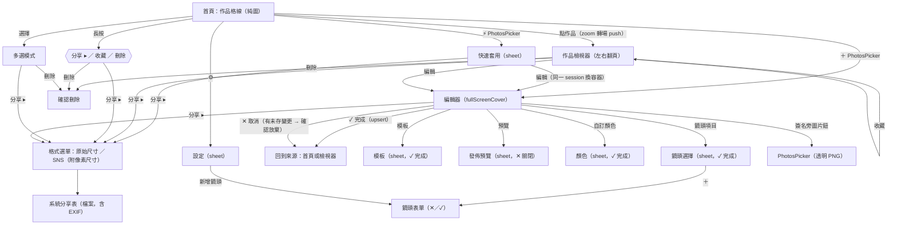

# PureAspectFrame UI 全面重構計畫

> 範圍：整個 App 的 UI 與其背後的排版／輸出／資料模型。輸入有五：A＝/how 盤點建議、B＝使用者已拍板決定、C＝使用者 9 項追加需求、D＝2026-10-21 確認的圖層編輯器（§16）、E＝2026-10-22 確認的編輯底部層級與視覺（§16.10、§16.11）。
> 本文件只規劃，不改碼。所有「註解」以 `> 註解：` 開頭，格式固定為「衝突／建議／決策問題」。
> 產生方式：兩輪 /architect。第一輪交叉評審後以候選 1 為底（§7）。第二輪編輯器以較完整的圖層契約為底，嫁接底色、簽名、單一畫布驅動者與 X 的 9:19（§16.2）。
> 使用方式：編輯器、文件、排版以 §16 為準。底部怎麼點以 §16.10 為準，視覺與 iPadOS 17 以 §16.11 為準。§10 標〔取消〕的不要做，標〔併入〕的不要另開實作。首頁與檢視器仍可從 Phase Q 開始。§14 裡 Q1、Q2、Q4 已由 §16 關閉；Q5、Q6、Q7 不阻塞 Phase E。

---

## 0. 核心形狀（五行摘要）

1. **一份文件**：`FrameDocument`（純值、Codable）是一件作品外觀的唯一真實來源；UI 狀態（分頁、選取的邊、連結編輯模式）另放 `EditorUIState`，永不持久化。
2. **一個場景**：`FrameScene(document:input:resolution:)` 是純函式排版引擎，在「輸出像素空間」解出所有幾何（長邊 %、px、比例優先、6 向對齊、相片框比例、零裁切、底欄、水印、切割），並回報有效留白與滑桿範圍。
3. **一支畫筆**：`FramePainter.paint(scene, assets, into: CGContext, scale:)` 同時供舞台（SwiftUI `Canvas.withCGContext`）與輸出（點陣 CGContext）使用 → 預覽＝輸出是「構造上成立」，不是「兩邊各自對齊」。
4. **一個工作階段**：`@Observable EditSession` 擁有文件、來源相片（漸進式載入，EXIF 晚到也會更新）、存檔基準（取消／完成判斷），並提供 `export(format)` 與冪等 `save(in:)`；編輯器、快速套用、重新開啟作品都只是建立不同的 session。
5. **一條路由**：根層 `AppRouter` 管理所有呈現（快速套用 sheet ↔ 編輯器 cover 互換、檢視器 push），作品格線點擊 → Photos 式檢視器（zoom 轉場）→ 編輯。

> 上列 1–4 是第一輪形狀。圖層編輯器改為：文件只存圖層（外加底色、簽名、鏡頭覆寫）、裁切在每張相片上、工具層的勾勾才推一步還原、離開不存檔。底部層級在 §16.10。契約在 §16，不要照本節去建 `PaddingSpec` 或四個常駐分頁，也不要把照片、邊框、資訊、切割同時排在底部。

---

## 1. 程式碼查核：grounding／需求文件與實際程式碼不符之處

以下皆已對照 `/Users/tcwang/Documents/PureAspectFrame` 與 `~/Documents/py-gif/src/watermark/wbg.py` 實際內容。

| # | 文件說法 | 實際程式碼 | 影響 |
|---|---|---|---|
| K1 | C8：「`CanvasStageView` 加 `.clipped()` + `.contentShape(Rectangle())`、頂部列 `.zIndex(100)`」即可修正手勢穿透 | SwiftUI 的 `.clipped()`／`.clipShape()` **不會**裁掉點擊範圍；手勢掛在 `.scaleEffect(scale).offset(offset)` 之後的 `Image` 上（`CanvasStageView.swift` L192-224），點擊範圍隨縮放放大。`EditorView` 的 `VStack` 中舞台宣告在頂部列之後，z 順序本來就在上面，所以頂部列 `.zIndex` **確實**能讓頂部鈕重新可點。 | zIndex 足以救回頂部鈕；但放大後的相片仍會吃掉舞台內標線數字等元素的觸控，需「不隨變形移動的點擊層」才完整，見 P8、N20。 |
| K2 | C6：「spacer 解除 2 個上限」 | 上限寫在**兩處**：`FooterItemType.unusedItems(active:)` 與 `FooterSettings.addItem`；且 `ImageRendererService.drawFooter` 與舞台都只畫 `sections[0...2]`，第 4 段之後**被靜默丟棄**。 | 只拿掉上限會讓第 3 個 spacer 之後的項目消失；需要重新定義 spacer 語意（L7、N16）。 |
| K3 | C5：「取消某邊連結後不得殘留藍框」 | 根因：`PaddingBoxWidget.caliper` 以 `groupIndex(of:)` 上色，**不檢查組員數 ≥ 2**；`BorderSettings.linkedPeers` 卻有檢查。兩處規則不一致。 | P1/P3 以單一 `LinkGroups.linkedSlot(of:)` 作為上色唯一依據。 |
| K4 | C5：「間距 ≥ 4pt，外框線與尺標不重疊」 | 目前 74×74 容器、尺標 38×23、中央方塊 30×30：上尺標 y∈[0,23]、中央方塊 y∈[22,52]，**已重疊 1pt**；尺標貼齊容器描邊。 | P2 用可測試的 `Metrics` 重排。 |
| K5 | C9：切割線現況 | 現為**雙層**：白 1.0pt（`splitCutLineWidth`）疊在黑 2.0pt（`splitCutLineBaseWidth`）上並加陰影；`UIWorkflowTests.testCanvasStageSplitPreviewAndCutLine` 斷言這些常數。 | L12 需同步改測試。 |
| K6 | grounding：「Export is always 1080 wide」 | 更糟：切割輸出的 1080 是**整張畫布寬**，3 等分後每片只有約 360px（`renderSlices` → `render(baseWidth: 1080)` → `cropping`）。 | X1 改為「每片 1080」。 |
| K7 | wbg.py `border_px = int(round(target_size * border_ratio / 2))` | `border_ratio` 是**上下（或左右）兩邊合計**佔長邊的比例（預設 0.16 ＝ 每邊 240/3000 = 8%）。App 目前的 % 是「單邊」值（預設 20、上限 40）。另外 `border_equal` + 固定比例分支呼叫 `compute_canvas_size(orig_w, orig_h, aspect_mode, aspect_ratio)` **少了 `target_size` 參數，會 TypeError**。 | 參考演算法只能取「長邊為基準」的概念，不能照抄係數；見 N3。 |
| K8 | wbg.py 的「等寬白邊」 | `border_equal` + `auto` 模式是**讓畫布長大**（畫布 = 相片 + 2×邊），畫布比例 ≠ 相片比例；這與 C3「比例絕對優先於留白」相反。 | 見 N4。 |
| K9 | BACKLOG：「舊系統自動降級為一般毛玻璃材質」 | 專案 `IPHONEOS_DEPLOYMENT_TARGET = 26.0`、`MACOSX_DEPLOYMENT_TARGET = 26.0`，所有 `if #available(iOS 26.0, *) … else …` 的 else 分支在目標仍是 26 時都是**死碼**。 | §16.11 改為保留退路：iOS 26 用 Liquid Glass，iPadOS 17 用系統材質。Z2 不再刪除。 |
| K10 | （未提及）macOS | `SUPPORTED_PLATFORMS` 含 `macosx`，但 `ImageRendererService.drawFooter` 整段包在 `#if canImport(UIKit)`：**macOS 輸出沒有底欄**。 | L8 以 CoreText 繪製，跨平台一致。 |
| K11 | （未提及）並行 | App target 設定 `SWIFT_DEFAULT_ACTOR_ISOLATION = MainActor`：`ImageRendererService.render` 實際在主執行緒跑；`SNSPreviewView` 的 sheet builder 內同步渲染。 | 新的純型別一律標 `nonisolated`，原圖輸出才能離開主執行緒（X2）。 |
| K12 | grounding 列的死碼 | 正確，另外補：`CanvasRatio.aspectRatio`（無參數版）、`CanvasRatio.isPolaroid`、`ManualLens.isFavorite`、`ArtworkRecord.bookmarkData`／`exifJSON`（從未寫入）、空資料夾 `PureAspectFrame/ViewModels/`、13 個只被測試讀取的 `static` 規格常數（`HomeView` 6 個、`FooterTabView` 4 個、`SNSPreviewView.usesLeadingCloseButton`／`actionIconNames`、`SNSTargetPlatform.supportsPinchToMerge`）。 | Z1、Z3。 |
| K13 | （未提及）持久化 | `CanvasRatio`、`InternalCropRatio`、`FooterItemType`、`PaddingEdge`、`MeasurementUnit`、`StoragePolicy` 的 **rawValue 就是中文顯示字串**，且寫進 SwiftData（`canvasRatioRaw`、`storagePolicyRaw`、`@AppStorage("default_storage_policy")`）與模板 JSON。 | 「統一命名」若直接改字串會讓舊資料解碼失敗；Z4、N23。 |
| K14 | （未提及）毛玻璃 | 輸出端 `CIGaussianBlur` 半徑以「來源相片像素」計：同一設定在 6000px 原圖上很淡、在 1600px 代理圖上很濃。舞台又是 `.blur(radius: r*0.4)` pt。 | L8 改以「長邊 %」定義半徑。 |
| K15 | （未提及）EXIF 寫回 | `ColorSpaceService.exportImageWithMetadata` 只寫 Make/Model/Lens/焦距/光圈/ISO，**沒寫快門、拍攝日期**；之後又被 `UIImage(data:)` 包裝分享而遺失。 | X3。 |
| K16 | （未提及）Photos 權限 | `HomeView` 快速路徑用 `PHAsset.fetchAssets(withLocalIdentifiers:)`；未取得相簿讀取授權時回傳空集合，快速路徑**靜默失效**，只剩慢速路徑。重新開啟「僅保留設定」作品也會撞到同一限制。 | N14、S2。 |
| K17 | 需求文件標題「10 大項目」 | 實際只列 9 項。 | N30。 |
| K18 | grounding「沒有 UI test」並未明說 | 只有 unit-test target；`ContentView` 的 `-UITestScreen-*` 啟動參數沒有任何 XCUITest 使用。 | Z5 新增 UI test target，否則「UI test 驗收」無處可跑。 |
| K19 | 底欄外觀 | 輸出端 `ImageRendererService` L270 以 `"  |  "`（直槓兩側各兩格）串接；舞台區塊之間 `HStack(spacing: 8)`（`CanvasStageView` L248）、區塊內 `HStack(spacing: 6)`（L452）。左右箭頭是已啟用卡片上的 `chevron.left`／`chevron.right`（`FooterTabView` L439／L465）；`arrow.left.and.right`（L605）是間距項目本身的圖示，要保留。 | L7、D2。 |
| K20 | 選取動畫與「Z 軸」 | 卡片點選是 `withAnimation(.spring)` + 勾勾 `.transition(.scale.combined(with: .opacity))`；底部列另有 `.animation(.spring, value: isSelectMode)`。「Z 軸浮起」來自卡片 `.liquidGlass(cornerRadius: 16)` 預設 `interactive: true` → `.glassEffect(.regular.interactive())`。 | Q2。 |
| K21 | SNS 尺寸 | `CanvasRatio.targetPixelSize(baseWidth:)` 鎖的是**寬**：4:5 → 1080×1350，9:16 → 1080×1920，但 16:9 橫式只有 1080×608。 | L3、N10。 |
| K22 | 「自由」舊資料 | `InternalCropRatio.init(rawValue:)` 把 `"自由"` 映成 `.square1x1`；已被重新存成 `"1:1"` 的舊模板**無法**分辨原本是自由。 | L2。 |

---

## 2. Problem

PureAspectFrame 要讓「上方舞台看到的」與「分享出去的檔案」逐像素同構，同時加入一整套新的排版規則（長邊 %、px 絕對對稱、比例優先、6 向對齊、自由／原圖／固定相片框、零裁切鎖定）、Photos 式作品庫（重新開啟、收藏、檢視器、長按三選項）、兩種輸出格式與無限 spacer＋圖片水印的底欄。困難點不在單一功能，而在現有結構：**排版被寫了兩次**（`CanvasStageView` 以 pt、`ImageRendererService` 以 1080 px，各自算留白／圓角／毛玻璃／底欄且互相不一致）、**編輯狀態沒有擁有者**（9 個 `@State` 隨畫面消失，EXIF 以 `State(initialValue:)` 只複製一次）、**作品無法回到編輯**（`settingsJSON = "{}"`）。必須遵守的既有限制：SwiftData 舊資料（`FrameTemplate`、`ArtworkRecord`、`ManualLens`）與中文 rawValue 的持久化鍵（K13）、預設 MainActor 隔離（K11）、iOS 26／macOS 26 雙平台（K10）、使用者已拍板的 B1–B6（尤其 B1 與 C2 互相拉扯，見 N1）。

---

## 3. Usage（呼叫端視角，先於型別）

### 3.1 README 式快速上手

```swift
// 1) 匯入：立即得到可編輯的 session（預覽圖 + 原圖真實像素尺寸），EXIF 與原圖稍後自動補上
let session = try await PhotoImporter.begin(pickerItem, template: selectedTemplate)
router.present(.editor(session))

// 2) 編輯：所有分頁直接改 session.document；舞台只讀 session.scene
session.document.padding.set(5, for: session.ui.padding.sliderTargets(session.document.padding.links))
session.document.photo.frameRatio = .r1x1

// 3) 分享：格式只有兩種，回傳帶 EXIF 的暫存檔 URL
let bundle = try await session.export(.sns)          // 或 .original
ShareSheet(items: bundle.files)

// 4) 完成：冪等 upsert（同一 session 存幾次都只有一筆作品）
try session.save(in: modelContext)
```

### 3.2 呼叫點一：舞台（預覽）

```swift
struct CanvasStageView: View {
    @Bindable var session: EditSession

    var body: some View {
        GeometryReader { proxy in
            let scene = session.scene                                   // 設計解析度（＝原始尺寸格式）的像素空間
            let fit = StageFit(canvas: scene.canvasSize, in: proxy.size, inset: 12)
            Canvas { ctx, _ in
                ctx.withCGContext { cg in
                    FramePainter.paint(scene, session.previewAssets, into: cg, scale: fit.scale)
                }
            }
            .frame(width: fit.size.width, height: fit.size.height)
            .overlay { SplitGuideOverlay(slices: scene.slices, scale: fit.scale) }          // 0.5pt #00FFFF
            .overlay { PaddingMarkersOverlay(report: scene.padding, scale: fit.scale, session: session) }
            .overlay {
                CropHitLayer(frame: scene.frame.scaled(fit.scale), isLocked: scene.isCropLocked,
                             onDrag: { session.document.photo.crop = $0 },
                             current: session.document.photo.crop, imagePointsPerPixel: fit.scale)
            }
            .position(fit.center)
        }
        .clipped()
    }
}
```

### 3.3 呼叫點二：重新開啟作品（檢視器 → 編輯）

```swift
Button("編輯") {
    Task {
        let session = try await EditSession.reopen(record, sources: photoSources)
        router.present(.editor(session))     // 完成 → 更新同一筆 record，回到檢視器
    }
}
```

### 3.4 呼叫點三：排版引擎單元測試（使用者需求即測試）

```swift
@Test func ratioPriorityPushesSlackToBottom() {
    var doc = FrameDocument()
    doc.canvas = CanvasSpec(ratio: .ig4x5, orientation: .portrait)
    doc.padding.unit = .percentOfLongEdge
    doc.padding.set(5,  for: [.top, .bottom])
    doc.padding.set(10, for: [.left, .right])
    doc.photo.frameRatio = .r1x1
    doc.footer.isEnabled = false

    let res = ExportFormat.sns.resolution(for: doc, photoPixelSize: CGSize(width: 4000, height: 3000))
    let scene = FrameScene(document: doc, input: .init(photoPixelSize: CGSize(width: 4000, height: 3000)), resolution: res)

    #expect(scene.canvasSize == CGSize(width: 1080, height: 1350))
    #expect(scene.frame == CGRect(x: 135, y: 68, width: 810, height: 810))
    #expect(scene.padding.effectivePx.bottom == 472)
    #expect(scene.padding.isConstrained.bottom)
    #expect(scene.padding.slackAxis == .vertical)
}
```

---

## 4. Shape

> §4.1–§4.3 是第一輪形狀，只留作對照。編輯器的擁有權、排版與型別以 §16 為準。不要實作本節的 `PaddingSpec`、`LinkGroups`、`FooterSpec`、`PhotoPlacement` 或未發布的文件 v2。

### 4.1 資料結構與擁有權

| 狀態 | 唯一擁有者 | 持久化 | 誰讀 |
|---|---|---|---|
| 作品外觀（比例、留白、對齊、相片框、裁切、背景、底欄、切割、水印參照、手動鏡頭覆寫） | `EditSession.document: FrameDocument` | `ArtworkRecord.documentJSON`、`FrameTemplate.documentJSON` | `FrameScene` |
| 編輯器 UI（分頁、選取的邊／連結編輯中的組、標線、面板收合） | `EditSession.ui: EditorUIState` | 否 | 分頁 View、舞台標線 |
| 來源相片（預覽代理圖、原圖真實像素尺寸、EXIF、asset id、原圖載入器） | `EditSession.source: SourcePhoto` | `assetLocalIdentifier`、`sourceProxyData`、`exifJSON` | session 推導 `scene`／`previewAssets` |
| 存檔基準 | `EditSession.savedDocument` | — | 取消鈕（有無未存變更） |
| 呈現（sheet／cover／push） | `AppRouter` | 否 | 根 View |

不變式由型別保證（per encode-lessons-in-structure）：

- **只有「原圖」且未零裁切才能縮放位移**：排版只讀 `PhotoSpec.placement: PhotoPlacement`；只有 `.adjustable` 這個 case 帶 `CropTransform`，`.zeroCrop` 與 `.fill` 沒有（見下方模式真相表）。
- **一條邊至多屬於一組連結**：`LinkGroups` 內部是 `[PaddingEdge: LinkSlot]` 字典，不是兩個可能重疊的 `Set`。
- **「已連結」＝組員 ≥ 2**：唯一判斷式 `LinkGroups.linkedSlot(of:)`；小工具上色、滑桿目標、舞台標線都呼叫它（修 K3）。
- **連結編輯模式 vs 一般模式**：`PaddingSelection` 是 enum（`.edges(Set)` / `.editingLink(LinkSlot)`），取代 `isLinkedActive + activeLinkSlot + selectedEdges` 三欄任意組合。
- **底欄 spacer 無限、其他項目唯一**：`FooterSpec.items` 為 `private(set)`，只能透過 `insert/move/remove` 修改。
- **水印位於底欄 ⇔ 底欄有 `.watermark` 項目**：唯一 mutator `FrameDocument.setWatermark(_:placement:)` 同時維護兩邊。
- **UI 狀態不進模板**：`FrameDocument` 沒有任何 UI 欄位（修「模板存了 isLinkedActive」）。

#### 4.1.1 模式真相表（相片框比例 × 零裁切）

| 相片框 | 零裁切 | 相片框幾何 | 相片在框內 | 拖曳／縮放／雙擊重設 |
|---|---|---|---|---|
| 自由 | 關 | ＝留白內框 | aspect-fill 置中（會裁） | 無 |
| 原圖 | 關 | 比例優先的原圖比例框 | `CropTransform` 裁切 | **有**，寫入文件，進輸出 |
| 1:1／4:5／3:2／16:9 | 關 | 比例優先的固定比例框（方向依 N7） | aspect-fill 置中 | 無，框的位置靠 6 向對齊 |
| 任一 | 開 | 比例優先的原圖比例框（＝原圖＋鎖定） | 完整顯示，不裁 | 無 |

- 選任一相片框晶片會把零裁切關掉；開零裁切時晶片列停用並顯示「原圖」（P9）。
- `PhotoPlacement` 是唯一解讀處：`.zeroCrop`／`.fill(InternalCropRatio)`／`.adjustable(CropTransform)`。
- 候選 2 的另一種解讀：零裁切＝「留白盒說了算，相片 aspect-fit 在盒內」，相片框就是留白盒。兩者相片位置相同（都在內框內 fit + 對齊）；差別在底欄與圓角跟著「留白盒」還是「相片」。本計畫取「跟著相片」，見 N6。

### 4.2 排版演算法規格（`FrameScene.init` 的契約）

所有計算在「輸出像素空間」（整數 px，左上原點）。舞台用「原始尺寸格式」的場景再等比縮到 pt；SNS 輸出用自己的場景（解析度不同但規則相同）。

1. **畫布尺寸**：`W×H = resolution.canvasPixelSize`；`L = max(W,H)`、`S = min(W,H)`。
2. **留白換算（C4）**
   - `%`：`px(e) = round(v(e) / 100 × L)`（單邊值，以長邊為基準；不使用 wbg 的 `/2`，見 N3）。
   - `px`：`px(e) = round(v(e) × resolution.pixelsPerDesignPixel)`（px 定義在「原始尺寸」輸出空間，見 N2）。
   - **每邊各自 round 一次，再由這些整數推導其餘幾何** → 等值的兩邊寬度必然逐像素相同。
3. **防溢出（C3）**：`minFrame = max(16, round(0.1 × S))`。若 `l + r > W − minFrame`，左右等比縮減；若 `t + b + F > H − minFrame`，上下等比縮減（F＝底欄帶高）。同時回報每邊的 `allowedRange`，滑桿不可能拉出溢出值。
4. **底欄帶高**：`F = footer.isEnabled ? round(capHeightRatio × S × 3.2) : 0`（沿用現行短邊基準，見 N17）。
5. **內框**：`C = (l, t, W − l − r, H − t − b − F)`。
6. **相片框比例 ρ（C2）**：`free` → 相片框 = `C`（無餘量，結束）；`original` 與零裁切 → 相片長寬比；固定比例 → 1:1／4:5／3:2／16:9，方向依 N7。
7. **比例優先（C3）**：相片框 = 「長寬比 ρ 在 C 內的最大矩形」（aspect-fit）。只會有一軸出現餘量（slack）。
   - 「上下留白優先於左右」＝寬度受限時上邊照設定、餘量往下（預設垂直對齊 top）。
   - 「下邊加大超過必要 → 內部等比縮小、左右對稱釋出」＝ C 變矮後改為高度受限，水平餘量依水平對齊（預設 center）分配。
   - 因此 C3 整條規則等價於：**aspect-fit + 對齊**，沒有特例分支。
8. **奇偶修正（px 絕對對稱）**：對齊為 center 且餘量為奇數時，相片框該軸縮 1px，讓兩側餘量整數相等。
9. **6 向對齊**：水平 leading/center/trailing 只在水平有餘量時生效；垂直 top/center/bottom 只在垂直有餘量時生效（`slackAxis` 回報給 UI 以停用另一軸，見 N5）。
10. **有效留白**：`top = frame.minY`、`bottom = H − frame.maxY − F`、`left = frame.minX`、`right = W − frame.maxX`；`isConstrained(e) = effective(e) > requested(e)`。
11. **下邊約束（C3）**：位於「錨點對側」的那一邊（例如垂直對齊 top 時的 bottom），其 `allowedRange.lowerBound = 該邊有效值`——設定值小於必要留空時被約束，滑桿不會出現「拉了沒反應」的死區。
12. **相片位置**（§4.1.1）：`.zeroCrop` → `imageRect = frame`；`.fill` → `aspectFill(photo, frame)` 置中；`.adjustable` → `aspectFill` 後套 `CropTransform`（scale ≥ 1、offset 夾限到永遠覆蓋相片框）。
13. **底欄帶**：`(frame.minX, frame.maxY, frame.width, F)`，跟著相片框走（見 N4 的延伸）。
14. **底欄內容**：項目以 CoreText 量測；spacer＝等分的彈性空白（N16）；總寬超出時整列等比縮小（下限 0.35）。
15. **圓角**：`%` → `min(frame.w, frame.h) × v / 100`（上限 50%）；`px` → `v × pixelsPerDesignPixel`。
16. **切割**：`slices` 由同一份 `SplitSpec` 推導；舞台與輸出共用。

#### 4.2.1 第一輪演算法範例（已作廢，不要寫成測試）

底欄關閉，SNS 4:5 直式 → 畫布 1080×1350，`L = 1350`。代號改為「舊算例」，避免與 Phase E 的任務 E1–E6、以及 §11 的 R1–R18 撞名。取代它們的算例是 §16.4 的 W1–W9。

| 範例 | 設定 | 結果 |
|---|---|---|
| 舊算例 1 | 四邊 5%，`free` | 每邊 `round(67.5) = 68`；相片框 `(68, 68, 944, 1214)` |
| 舊算例 2 | 上下 5%、左右 10%，1:1 | `C = (135, 68, 810, 1214)` → 相片框 `810×810` 於 `(135, 68)`；有效下邊 472（受約束），`slackAxis = .vertical` |
| 舊算例 3 | 同舊算例 2 但下邊 40%（540px） | `C.h = 742` → 相片框 `742×742`，水平餘量 68 → 左右各 34 → `x = 169`，左右有效值皆 169 |
| 舊算例 4 | 四邊 100 px；原圖長邊 5000 | 原始尺寸格式：每邊 100px；SNS（長邊 1350）：每邊 `round(100 × 1350/5000) = 27`，四邊逐像素相等 |
| 舊算例 5 | `C.w = 811`、相片框寬 742、水平置中 | 餘量 69 為奇數 → 相片框寬改 741 → 左右各 35 |
| 舊算例 6 | 零裁切、3:2 橫圖、四邊 5% | `C = 944×1214` → 相片框 `944×629` 於 `(68, 68)`；有效下邊 653；`isCropLocked = true` |

### 4.3 型別草圖（load-bearing 新元件）

> 全部 `nonisolated`（K11），除了 `EditSession`、`AppRouter` 與 View。檔案位置：`Models/Document/*`、`Services/Layout/*`、`Services/Export/*`、`ViewModels/*`（沿用目前空著的資料夾）。

#### 4.3.1 文件模型

```swift
import CoreGraphics
import Foundation

nonisolated enum PaddingEdge: String, Codable, CaseIterable, Sendable {
    case top, bottom, left, right
    /// 舊 rawValue「上／下／左／右」相容解碼（K13）
    init(from decoder: Decoder) throws { fatalError("not implemented") }
    static let canonicalOrder: [PaddingEdge] = [.top, .bottom, .left, .right]
}

nonisolated struct EdgeValues<Value> {
    var top: Value, bottom: Value, left: Value, right: Value
    subscript(edge: PaddingEdge) -> Value {
        get { fatalError("not implemented") }
        set { fatalError("not implemented") }
    }
}
extension EdgeValues: Equatable where Value: Equatable {}
extension EdgeValues: Codable where Value: Codable {}
extension EdgeValues: Sendable where Value: Sendable {}

/// 一件作品外觀的唯一真實來源。沒有任何 UI 狀態。
nonisolated struct FrameDocument: Codable, Equatable, Sendable {
    static let schemaVersion = 2
    var canvas = CanvasSpec()
    var photo = PhotoSpec()
    var padding = PaddingSpec()
    var background = BackgroundSpec()
    var footer = FooterSpec()
    var split = SplitSpec()
    var watermark: WatermarkSpec? = nil
    var lensOverride: LensOverride? = nil

    init() {}

    /// 舊 BorderSettings / BackgroundMode / FooterSettings / SplitSettings → v2。
    /// 舊 % 為「該軸長度」基準，依畫布比例換算為長邊基準（N3）；UI 欄位（isLinkedActive 等）丟棄。
    init(legacy: LegacyFrameSettings, photoAspect: Double?) { fatalError("not implemented") }

    /// 唯一能改變水印位置的入口：底欄 ⇔ items 含 .watermark；畫布 ⇔ canvasAnchor != nil
    mutating func setWatermark(_ assetID: UUID?, placement: WatermarkPlacement) { fatalError("not implemented") }

    /// 來源 EXIF 合併手動鏡頭覆寫（只覆寫鏡頭名與焦距，絕不覆寫光圈值）
    func effectiveExif(_ source: ExifMetadata?) -> ExifMetadata { fatalError("not implemented") }

    /// 套用模板：保留本張相片專屬的 crop / lensOverride（見 R17）
    mutating func apply(template: FrameDocument) { fatalError("not implemented") }

    /// 模板副標，例如「4:5 · 留白 5% · 白」或「1:1 · 留白 120px · 毛玻璃」
    var summary: String { fatalError("not implemented") }
}

nonisolated enum Orientation: String, Codable, Sendable { case portrait, landscape }

nonisolated struct CanvasSpec: Codable, Equatable, Sendable {
    var ratio: CanvasRatio = .ig4x5
    var orientation: Orientation = .portrait
    /// 方向切換對此比例是否有意義（1:1、原圖比例 → false，UI 停用切換）
    var orientationMatters: Bool { fatalError("not implemented") }
    func aspect(photoAspect: Double) -> Double { fatalError("not implemented") }
}

nonisolated enum InternalCropRatio: String, Codable, CaseIterable, Sendable {
    case free, original, r1x1, r4x5, r3x2, r16x9
    /// 舊值「自由」→ .free（現行程式錯把它映射成 1:1）、「1:1」「4:5」「3:2」「16:9」
    init(from decoder: Decoder) throws { fatalError("not implemented") }
    /// nil ＝ free（相片框＝留白內框）
    func frameAspect(photoAspect: Double, orientation: Orientation) -> Double? { fatalError("not implemented") }
}

nonisolated struct CropTransform: Codable, Equatable, Sendable {
    /// ≥ 1，相對於 aspect-fill
    var scale: Double = 1
    /// 以 imageRect 尺寸正規化的位移
    var offset: CGPoint = .zero
    static let identity = CropTransform()
    func dragged(byPixels translation: CGSize, imageSize: CGSize) -> CropTransform { fatalError("not implemented") }
    func pinched(by factor: Double) -> CropTransform { fatalError("not implemented") }
    /// 夾限：scale ∈ [1, 5]，且 imageRect 永遠覆蓋相片框
    func clamped(imageSize: CGSize, frame: CGSize) -> CropTransform { fatalError("not implemented") }
}

nonisolated struct PhotoAlignment: Codable, Equatable, Sendable {
    enum Horizontal: String, Codable, CaseIterable, Sendable { case leading, center, trailing }
    enum Vertical: String, Codable, CaseIterable, Sendable { case top, center, bottom }
    var horizontal: Horizontal = .center
    var vertical: Vertical = .top
}

nonisolated enum CornerRadius: Codable, Equatable, Sendable {
    case percentOfFrameShortSide(Double)
    case designPixels(Double)
}

/// §4.1.1 模式真相表的唯一解讀處
nonisolated enum PhotoPlacement: Equatable, Sendable {
    case zeroCrop                          // 原圖比例框、完整顯示、無手勢
    case fill(InternalCropRatio)           // 自由或固定比例：aspect-fill 置中、無手勢
    case adjustable(CropTransform)         // 原圖：可拖曳縮放
}

nonisolated struct PhotoSpec: Codable, Equatable, Sendable {
    var frameRatio: InternalCropRatio = .free
    var isZeroCrop = false
    /// 只有 placement == .adjustable 時被讀取
    var crop = CropTransform.identity
    var alignment = PhotoAlignment()
    var cornerRadius = CornerRadius.percentOfFrameShortSide(0)
    var placement: PhotoPlacement {
        if isZeroCrop { return .zeroCrop }
        return frameRatio == .original ? .adjustable(crop) : .fill(frameRatio)
    }
    var allowsCropGesture: Bool { if case .adjustable = placement { true } else { false } }
}

nonisolated enum PaddingUnit: String, Codable, Sendable { case percentOfLongEdge, designPixels }
nonisolated enum LinkSlot: Int, Codable, CaseIterable, Sendable { case a, b }

nonisolated struct LinkGroups: Codable, Equatable, Sendable {
    private var slotByEdge: [PaddingEdge: LinkSlot]
    static let allInA = LinkGroups(slotByEdge: [.top: .a, .bottom: .a, .left: .a, .right: .a])
    func members(_ slot: LinkSlot) -> Set<PaddingEdge> { fatalError("not implemented") }
    /// 只有該組成員 ≥ 2 才回傳；小工具上色、滑桿、標線的唯一依據
    func linkedSlot(of edge: PaddingEdge) -> LinkSlot? { fatalError("not implemented") }
    func peers(of edge: PaddingEdge) -> Set<PaddingEdge> { fatalError("not implemented") }
    /// 已在該組 → 移出；在另一組 → 移入此組；未歸屬 → 加入
    mutating func toggle(_ edge: PaddingEdge, in slot: LinkSlot) { fatalError("not implemented") }
}

nonisolated struct PaddingSpec: Codable, Equatable, Sendable {
    var unit: PaddingUnit = .percentOfLongEdge
    private(set) var values = EdgeValues<Double>(top: 5, bottom: 5, left: 5, right: 5)
    var links = LinkGroups.allInA
    mutating func set(_ value: Double, for edges: Set<PaddingEdge>) { fatalError("not implemented") }
    /// %/px 互換時數值等價換算（修「切換單位不換算」）
    mutating func convert(to unit: PaddingUnit, designLongEdgePx: Double) { fatalError("not implemented") }
}

nonisolated struct HSBColor: Codable, Equatable, Sendable { var h: Double, s: Double, b: Double }
nonisolated struct RGBColor: Codable, Equatable, Sendable {
    var r: Double, g: Double, b: Double
    static let footerGray = RGBColor(r: 0x8E / 255, g: 0x8E / 255, b: 0x93 / 255)
}

nonisolated struct BackgroundSpec: Codable, Equatable, Sendable {
    enum Kind: String, Codable, Sendable { case white, black, custom, frosted }
    var kind: Kind = .white
    /// 切到其他模式也保留，回來時復原（修「切分頁後自訂色／模糊值重設」）
    var customColor = HSBColor(h: 0, s: 0, b: 0.95)
    /// 長邊的百分比，與輸出解析度、來源解析度無關（K14）
    var frostRadiusPercentOfLongEdge: Double = 2.5
}

nonisolated struct SplitSpec: Codable, Equatable, Sendable {
    var isEnabled = false
    var count = 2                       // 2...10
    /// 以 SNS 輸出像素為單位；原始尺寸格式等比換算
    var gapSNSPixels: Double = 0
    var preset: SNSPlatform? = nil      // nil ＝ 自訂
}

nonisolated struct LensOverride: Codable, Equatable, Sendable {
    var manualLensID: UUID
    var displayName: String
    var focalLength: Double?
}
```

#### 4.3.2 底欄項目模型（無限 spacer + 圖片水印）

```swift
nonisolated enum FooterItemKind: String, Codable, CaseIterable, Sendable {
    case logo, camera, lens, parameters, date, signature, watermark, spacer
    var isUnique: Bool { self != .spacer }
}

nonisolated struct FooterItem: Codable, Hashable, Identifiable, Sendable {
    let id: UUID                 // spacer 也有獨立身分 → 拖曳排序不再需要 layoutRevision hack
    let kind: FooterItemKind
}

nonisolated struct FooterSpec: Codable, Equatable, Sendable {
    var isEnabled = true
    private(set) var items: [FooterItem] = FooterSpec.defaultItems
    /// 大寫字高佔畫布短邊比例（沿用 commit 109ec6e 的短邊基準，N17）
    var capHeightRatio: Double = 0.018
    var textColor = RGBColor.footerGray
    var signatureText = ""

    static let defaultItems: [FooterItem] = []   // TODO: [.logo, .camera, .spacer, .lens, .parameters]

    /// 調色盤：未使用的唯一項目 + 永遠可用的 spacer。lens / signature 永遠可加（修兩個死路）。
    var paletteKinds: [FooterItemKind] { fatalError("not implemented") }
    /// spacer：插入新的一個；唯一項目：已存在則移動到 index
    mutating func insert(_ kind: FooterItemKind, at index: Int) { fatalError("not implemented") }
    mutating func move(_ id: FooterItem.ID, to index: Int) { fatalError("not implemented") }
    mutating func remove(_ id: FooterItem.ID) { fatalError("not implemented") }
    /// 舊 [FooterItemType]（rawValue「品牌標誌」…「間距調整」）相容解碼
    init(from decoder: Decoder) throws { fatalError("not implemented") }
}

nonisolated enum CanvasAnchor: String, Codable, CaseIterable, Sendable {
    case topLeading, top, topTrailing, leading, center, trailing, bottomLeading, bottom, bottomTrailing
}
nonisolated enum WatermarkPlacement: Equatable, Sendable { case footer, canvas(CanvasAnchor) }

nonisolated struct WatermarkSpec: Codable, Equatable, Sendable {
    var assetID: UUID                    // → WatermarkAsset（SwiftData）
    var canvasAnchor: CanvasAnchor?      // nil ⇔ 位於底欄（items 必含 .watermark）
    var widthPercentOfLongEdge: Double = 12
}
```

#### 4.3.3 排版引擎與共用畫筆

```swift
nonisolated struct SceneInput: Equatable, Sendable {
    var photoPixelSize: CGSize                 // 原圖真實尺寸（即使原圖尚未解碼完成）
    var exif: ExifMetadata = ExifMetadata()    // 已合併 lensOverride
    var watermarkPixelSize: CGSize? = nil
}

nonisolated struct OutputResolution: Equatable, Sendable {
    let canvasPixelSize: CGSize
    /// px 單位換算：設計（原始尺寸格式）1px 在本輸出等於幾 px（N2）
    let pixelsPerDesignPixel: CGFloat
}

nonisolated enum SlackAxis: Equatable, Sendable { case horizontal, vertical }

nonisolated struct PaddingReport: Equatable, Sendable {
    let requestedPx: EdgeValues<CGFloat>
    let effectivePx: EdgeValues<CGFloat>
    let isConstrained: EdgeValues<Bool>
    /// 以文件單位（% 或 px）表示的滑桿範圍：上限防溢出、下限避免死區
    let allowedRange: EdgeValues<ClosedRange<Double>>
    let slackAxis: SlackAxis?
}

nonisolated enum ResolvedBackground: Equatable, Sendable {
    case color(RGBColor)
    case frosted(radiusPx: CGFloat)
}

nonisolated enum FooterRun: Equatable, Sendable {
    case text(String, FooterTextStyle, CGRect)
    case brand(BrandMark, CGRect)              // 品牌字標資料化，CoreText 繪製（取代 SwiftUI-only 的 CameraBrandLogoView）
    case watermark(CGRect)
}

nonisolated struct FooterScene: Equatable, Sendable {
    let band: CGRect
    let runs: [FooterRun]
    let textColor: RGBColor
}

/// 純函式排版結果：畫一張圖需要的全部幾何與樣式。舞台與輸出共用。
nonisolated struct FrameScene: Equatable, Sendable {
    let canvasSize: CGSize
    let background: ResolvedBackground
    let frame: CGRect
    let cornerRadius: CGFloat
    let imageRect: CGRect
    let isCropLocked: Bool
    let footer: FooterScene?
    let canvasWatermark: CGRect?
    let slices: [CGRect]
    let padding: PaddingReport

    init(document: FrameDocument, input: SceneInput, resolution: OutputResolution) {
        // TODO 依 §4.2 步驟 1–16：
        // 1 W,H,L,S ← resolution
        // 2 requested px（每邊獨立 round）
        // 3 防溢出等比縮減 + allowedRange
        // 4 F ← footer cap height × 3.2
        // 5 C ← 內框
        // 6 ρ ← photo.placement / frameAspect
        // 7 frame ← aspectFit(ρ, C)；8 奇偶修正；9 對齊
        // 10 effective / isConstrained；11 錨點對側邊的 lowerBound
        // 12 imageRect ← zeroCrop ? frame : aspectFill + crop.clamped
        // 13–14 footer band + CoreText runs（spacer 等分）
        // 15 cornerRadius；16 slices
        fatalError("not implemented")
    }
}

/// 每個「繪製表面」各自準備：舞台用預覽代理圖、輸出用原圖。毛玻璃預先模糊並依表面的像素密度換算半徑。
nonisolated struct RenderAssets: Sendable {
    let photo: CGImage
    let backdrop: CGImage?
    let watermark: CGImage?
    static func prepare(photo: CGImage, watermark: CGImage?, for scene: FrameScene) -> RenderAssets {
        // TODO: radiusInSourcePx = scene.background.radiusPx × (photo 寬 / 背景填滿寬)；CIGaussianBlur(clampedToExtent)
        fatalError("not implemented")
    }
}

nonisolated enum FramePainter {
    /// scene 座標為輸出 px、左上原點；scale = 目標表面每 px 對應的單位（舞台 pt/px，輸出 1）
    static func paint(_ scene: FrameScene, _ assets: RenderAssets, into cg: CGContext, scale: CGFloat) {
        fatalError("not implemented")
    }
    static func render(_ scene: FrameScene, _ assets: RenderAssets) -> CGImage? { fatalError("not implemented") }
}
```

#### 4.3.4 輸出格式

```swift
nonisolated enum ExportFormat: String, Codable, CaseIterable, Sendable {
    /// 原始尺寸：畫布長邊 = 原圖長邊（上限 originalLongEdgeCap），同 wbg 的 output_size = "max"
    case original
    /// SNS：直式與正方形寬 1080（4:5 → 1080×1350）；橫式長邊 1920（16:9 → 1920×1080）；切割時「每片」寬 1080
    case sns

    static let snsSliceWidth: CGFloat = 1080
    static let originalLongEdgeCap: CGFloat = 8192   // N29

    func resolution(for doc: FrameDocument, photoPixelSize: CGSize) -> OutputResolution { fatalError("not implemented") }
    /// 選單副標用，例如「4000 × 5000」「1080 × 1350 · 3 張」
    func pixelSizeLabel(for doc: FrameDocument, photoPixelSize: CGSize) -> String { fatalError("not implemented") }
}

nonisolated struct ExportBundle: Sendable {
    let format: ExportFormat
    let files: [URL]          // 暫存 JPEG，含完整 EXIF（K15），檔名 PureAspect_yyyyMMdd_HHmmss[_n].jpg
    let slicePixelSize: CGSize
}

nonisolated enum Exporter {
    static func export(_ doc: FrameDocument, input: SceneInput, photo: CGImage, watermark: CGImage?,
                       format: ExportFormat) throws -> ExportBundle { fatalError("not implemented") }
}
```

#### 4.3.5 編輯工作階段（session 擁有者）

```swift
import Observation
import SwiftData

nonisolated struct SourcePhoto: Sendable {
    var preview: CGImage                       // 長邊 ≤ 2048
    var pixelSize: CGSize                      // 真實原圖尺寸（PHAsset.pixelWidth/Height 立即可得）
    var exif: ExifMetadata?                    // nil ＝ 尚未解析；絕不填 demo EXIF
    var assetLocalIdentifier: String?
    var loadFullImage: @Sendable () async throws -> CGImage
}

enum PaddingSelection: Equatable, Sendable {
    case edges(Set<PaddingEdge>)
    case editingLink(LinkSlot)
    /// 連結編輯中 → 該組全部成員（C5「滑桿直接調整該連結已包含的邊」）；否則 → 選中邊的 peers
    func sliderTargets(_ links: LinkGroups) -> Set<PaddingEdge> { fatalError("not implemented") }
    /// 固定順序 top, bottom, left, right 中第一個 → 取代 Set.first 的不穩定順序
    func representativeEdge(_ links: LinkGroups) -> PaddingEdge? { fatalError("not implemented") }
}

struct EditorUIState: Equatable {
    var tab: EditorTab = .ratio
    var padding: PaddingSelection = .edges(Set(PaddingEdge.allCases))
    var showsMarkers = false
    var isPanelCollapsed = false
}

@MainActor @Observable
final class EditSession: Identifiable {
    /// 作品 ID：save 以此 upsert，存幾次都只有一筆
    let id: UUID
    private(set) var source: SourcePhoto
    var document: FrameDocument
    var ui = EditorUIState()
    private(set) var savedDocument: FrameDocument?
    var hasUnsavedChanges: Bool { savedDocument != document }

    /// 原始尺寸格式解析度下的場景；以 (document, source.pixelSize, exif) 為鍵快取
    var scene: FrameScene { fatalError("not implemented") }
    /// 預覽代理圖 + 依 scene 背景預模糊；以 (preview, frost 半徑) 為鍵快取
    var previewAssets: RenderAssets { fatalError("not implemented") }
    var effectiveExif: ExifMetadata { document.effectiveExif(source.exif) }

    init(id: UUID = UUID(), source: SourcePhoto, document: FrameDocument, savedDocument: FrameDocument? = nil) {
        fatalError("not implemented")
    }
    static func reopen(_ record: ArtworkRecord, sources: PhotoSources) async throws -> EditSession { fatalError("not implemented") }

    /// 原圖或 EXIF 晚到：只更新 source，不動 document（修快速路徑 demo EXIF）
    func receive(exif: ExifMetadata?, pixelSize: CGSize?) { fatalError("not implemented") }
    func apply(_ template: FrameTemplate) { fatalError("not implemented") }

    /// 離開主執行緒渲染；回傳暫存檔
    func export(_ format: ExportFormat) async throws -> ExportBundle { fatalError("not implemented") }

    /// 冪等 upsert：以 id 找 ArtworkRecord，寫 documentJSON、縮圖、依 StoragePolicy 決定是否存輸出圖；savedDocument = document
    @discardableResult
    func save(in context: ModelContext) throws -> ArtworkRecord { fatalError("not implemented") }
}

@MainActor @Observable
final class AppRouter {
    enum Sheet: Identifiable { case quickApply(EditSession), settings; var id: String { fatalError("not implemented") } }
    var sheet: Sheet?
    var editor: EditSession?            // fullScreenCover(item:)
    var viewerPath: [UUID] = []         // NavigationStack path（作品 ID）

    /// 快速套用 → 編輯：同一個 session 換容器（先收 sheet 再開 cover）
    func openEditor(_ session: EditSession) { fatalError("not implemented") }
    func closeEditor() { fatalError("not implemented") }
}
```

#### 4.3.6 作品／收藏／重新開啟的持久化模型

```swift
enum ArtworkSchemaV1: VersionedSchema { /* 現行 ArtworkRecord / FrameTemplate / ManualLens 原樣凍結 */ }
enum ArtworkSchemaV2: VersionedSchema { /* 下列模型 */ }
enum AppMigrationPlan: SchemaMigrationPlan { /* V1 → V2：lightweight + 自訂 stage 轉換 settingsJSON → documentJSON */ }

@Model
final class ArtworkRecord {
    @Attribute(.unique) var id: UUID
    var title: String                           // 相機型號，否則「未命名作品」
    var isFavorite: Bool = false
    @Attribute(originalName: "settingsJSON") var documentJSON: String
    var exifJSON: String?                       // 來源 EXIF 快照（離線重繪底欄用）
    var assetLocalIdentifier: String?
    @Attribute(.externalStorage) var sourceProxyData: Data?     // 長邊 2048 HEIC，重新開啟不需相簿權限（N14）
    @Attribute(.externalStorage) var thumbnailData: Data?       // 長邊 512，與輸出圖分開
    @Attribute(.externalStorage) var exportedImageData: Data?   // 僅 StoragePolicy.keepRenderedImage
    var storagePolicyRaw: String
    var diskSizeBytes: Int64
    var createdAt: Date
    var updatedAt: Date
    init(id: UUID, document: FrameDocument, source: SourcePhoto) { fatalError("not implemented") }
}

@Model
final class WatermarkAsset {
    @Attribute(.unique) var id: UUID
    @Attribute(.externalStorage) var pngData: Data
    var pixelWidth: Int
    var pixelHeight: Int
    var createdAt: Date
    init(id: UUID = UUID(), pngData: Data, pixelSize: CGSize) { fatalError("not implemented") }
}
```

#### 4.3.7 一致性元件（讓「看起來對的改法」對全 repo 也對）

```swift
/// 全 App 唯一的分享入口：兩個格式，副標是像素尺寸
struct ShareFormatMenu<Label: View>: View {
    let sizes: (ExportFormat) -> String
    let share: (ExportFormat) async throws -> ExportBundle
    @ViewBuilder var label: () -> Label
    var body: some View { fatalError("not implemented") }
}

/// 編輯器以外的關閉／確認工具列：✕ = 不保存離開；✓ = 確認並離開。
/// 編輯器底部的 ✕／✓ 是 §16.10，不使用這個元件。
struct DismissToolbar: ToolbarContent {
    enum Leading { case none, cancel(confirmDiscard: Bool, action: () -> Void), close(() -> Void) }
    enum Trailing { case none, done(() -> Void), save(enabled: Bool, () -> Void) }
    let leading: Leading
    let trailing: Trailing
    var body: some ToolbarContent { fatalError("not implemented") }
}

/// 鍵盤上方 ✓ 收回（簽名欄位、Hex 輸入共用）
struct KeyboardDoneToolbar: ViewModifier {
    var focus: FocusState<Bool>.Binding
    func body(content: Content) -> some View { fatalError("not implemented") }
}
```

### 4.4 介面深度判斷

- `FrameScene.init` 一個入口藏起：單位換算、四捨五入策略、防溢出、比例優先、對齊、奇偶修正、相片框比例、零裁切、裁切夾限、底欄 CoreText 排版、spacer 語意、水印位置、切割、滑桿範圍。呼叫端（舞台、輸出、測試）只給「文件 + 相片尺寸 + 解析度」。
- `FramePainter.paint` 一個入口藏起：座標翻轉、圓角裁切、毛玻璃、品牌字標、文字顏色、水印。
- `EditSession` 對 View 只暴露 `document`（可綁定）、`ui`、`scene`、`previewAssets`、`export`、`save`；漸進式載入、快取、upsert、存檔基準都在裡面。
- 刻意**不做**：View 不得自行計算任何留白／幾何（舞台標線也讀 `scene.padding`）；不提供第二條輸出路徑（`ImageRendererService` 在 L9 降為薄包裝，S 階段結束時刪除）。

---

## 5. 目標導覽圖



與現況差異：格線點擊有目的地（檢視器）；編輯器關閉一律回來源（不再回快速套用）；所有分享經過同一個格式選單；長按只有三項；設定與編輯器共用同一份鏡頭表單。

上圖裡編輯器的「✓ 完成／✕ 取消」是第一輪。圖層編輯器的離開在漢堡，不存做到一半的稿；底部的 ✕／✓ 是 §16.10 的套用與取消，不是完成並離開。

---

## 6. 全域一致性規範（U 階段落實，之後所有新畫面照用）

### 6.1 關閉／確認鈕規則

規則：**✕ ＝ 不保存離開**（有未存變更時先確認「放棄變更」）；**✓ ＝ 確認並離開**；**即時套用的面板只有 ✓**；push 進來的畫面用系統返回鈕。一律走 `DismissToolbar`，禁止文字版「完成／關閉／取消」按鈕（alert／confirmationDialog 的取消除外）。編輯器底部的 ✕／✓ 不走這條，語意見 §16.10；離開編輯器用漢堡裡的「離開」。

| 畫面 | 左上 | 右上 | 現況 |
|---|---|---|---|
| 編輯器 | 漢堡「離開」（有未提交草稿 → 確認放棄） | 圖層 | 底部 ✕／✓ 見 §16.10，右上沒有完成 |
| 快速套用 | ✕ 關閉 | — | ✕ 標「取消」 |
| 發佈預覽 | ✕ 關閉 | — | ✕ 標「取消」 |
| 模板 | — | ✓ 完成 | 文字「完成」 |
| 顏色選擇 | — | ✓ 完成 | 文字「完成」 |
| 鏡頭選擇 | — | ✓ 完成、＋ | 文字「關閉」「新增」 |
| 鏡頭表單 | ✕ 取消 | ✓ 儲存 | 底欄版文字「取消／儲存並套用」，設定版 ✕／✓ |
| 設定 | — | ✓ 完成 | 已是 ✓ |
| 首頁選擇模式 | — | ✕ 結束選擇 | ✕ 但 a11y 標「完成」 |
| 作品檢視器 | ‹ 返回 | 編輯 | （新） |

### 6.2 命名詞彙表（顯示字串，持久化鍵不受影響，見 Z4）

| 概念 | 統一用語 | 取代 |
|---|---|---|
| 歷史成品 | 作品 | 項目、相片、件 |
| 數量 | 「N 張」（已選取 N 張） | 個項目、張相片、個作品、件 |
| 分享 | 分享 | 導出、直接導出、導出作品、匯出 |
| 兩種輸出 | 原始尺寸、SNS | 原圖解析度、SNS 適合解析度、完整存圖 |
| 快速流程 | 快速套用 | 快速導入、快速導出、快速導入預覽 |
| 進入編輯 | 編輯 | 自訂編輯、進階微調 |
| 鏡頭 | 鏡頭／手動鏡頭 | 老鏡、鏡頭型號、手動老鏡、老鏡設備庫、鏡頭積木 |
| 底欄單位 | 項目 | 積木 |
| 彈性空白 | 間距 | 間距調整、彈性間距 |
| 儲存方式 | 保留輸出圖片／僅保留設定 | 已存圖／僅設定、完整存圖／僅存設定 |
| 文字簽名／圖片 | 簽名／水印 | 自訂簽名 |
| 相片框比例 | 相片框：自由、原圖、1:1、4:5、3:2、16:9 | 內部相片框比例 |
| 發佈模擬 | 發佈預覽 | SNS 預覽、SNS 發佈預覽 |
| 預設標題 | 相機型號，否則「未命名作品」 | 純淨畫布、快速導出、Untitled |

### 6.3 元件規範

- **分段控制**：數值選擇一律系統 `Picker(.segmented)`（%/px、直／橫〔僅圖示〕、HSB/RGB、發佈平台）。編輯器底部不是 `EditorTabBar`，層級見 §16.10。刪除自製直式／橫式與 HSB/RGB 切換列。
- **選取晶片**：單一 `SelectableChipStyle`（選中：accent 填色＋白字；未選：primary 6%）。背景模式、底欄文字色改用同一款（現為 primary 15% 另一套）。
- **數值顯示**：可調整的數值一律 `EditableNumberBadge`（留白、圓角、模糊、字級、間隙、切割張數）；唯讀資訊用純文字。
- **尺寸**：圓形鈕一律 `ChromeMetrics.circle = 44`（首頁 48／50 改 44）、圖示 17pt、卡片圓角 16（底欄 14 改 16）、編輯面板固定高度 `EditorPanelMetrics.height`（取 320，內容可捲動；不再 295／385 跳動）。

---

## 7. Synthesis decision

兩個候選在不同模型上獨立產生：候選 1（Claude Opus 5.5）、候選 2（Grok 4.7）。另由 Grok 4.7 做交叉評審，評分如下（1–5）。

| 準則 | 候選 1 | 候選 2 |
|---|---|---|
| 需求覆蓋 | 5 | 3 |
| 註解品質 | 5 | 4 |
| 結構健全 | 5 | 3 |
| 可逐步建置的順序 | 5 | 3 |
| 變更後再審視 | 5 | 4 |
| 可用性 | 4 | 4 |

**基底：候選 1。** 評審與我各自評分後都選它。理由：一份 `FrameDocument`、一個 `FrameScene`、一支 `FramePainter` 同時供舞台與輸出，preview＝export 由構造保證；L10 先橋接舊的 9 個 `@State`，每期都能建置。候選 2 的形狀在三處不成立：舞台與輸出各畫一次相片、合成器綁 MainActor、任務順序寫死會先用到後面才新增的 `InternalCropRatio.free`（照順序做不會編譯）。

**嫁接自候選 2：**

1. 模式真相表（§4.1.1）：只有「原圖」且未零裁切才有拖曳縮放；自由、固定比例置中填滿，位置靠 6 向對齊。原候選 1 允許所有非零裁切模式拖曳。
2. SNS 橫式長邊 1920（L3、X1、N10），修掉現行 16:9 只有 1080×608。
3. 底欄事實（K19）：輸出分隔是 `"  |  "`、舞台區塊間 8pt／區塊內 6pt；刪 `chevron.left/right`、保留間距的 `arrow.left.and.right`；VoiceOver 用 `accessibilityMove`。另補 K21、K22。
4. 切割線只是舞台覆疊、絕不進檔（L12 驗收）。
5. 首頁純視覺三項提前為 Phase Q，不等排版引擎。
6. N22 補上「切片縫與仿社群間距是兩件事」的另一種解法。

**修正候選 1 的錯誤：** 底欄分隔字串與間距（K19）；K1／N20 原說只有固定點擊層才能修頂部鈕，實際上頂部列 zIndex 就能，固定點擊層是為了舞台內的標線數字。

**拒絕自候選 2：** 作品重開後「每次導出新增一列」（改以 session id upsert，同 Photos 編輯同一張）；仿社群間距與切片縫合併的反面（保留為 N22 選項）；底欄用系統 `.draggable`（需長按，不符 C6 的「即時」，見 N15）；`FooterStrip` 經 `ImageRenderer` 光柵化（綁 MainActor、輸出解析度受限）。

**收斂：** 兩者都主張單一排版函式、`@Observable EditSession`、`ExportFormat` 兩值、分享完成才入庫、wbg 的 `/2` 不照抄。當時還收斂在「不做 undo」與「px 必須擇一基準」；這兩點已被 §16 覆寫：每次工具層勾勾一步還原（選項層的勾勾不算，§16.10），介面沒有 px。

### 7.1 第二輪（圖層編輯器）

沒有另開交叉評審。兩份差異都對著同一份已確認需求寫，由本文件直接合成。

**基底：** 單位空間封閉解、拖曳反解、星狀比例連結、算例、以及 E1–E28 的任務切分。

**嫁接：**

1. `FrameDocument` 除了 `layers`、`lensOverride`，還有 `background` 與 `signatureText`。底色會從半透明環透出來，底色不是第一圈邊框。
2. `schemaVersion = 3`。不要實作第一輪未發布的 v2（`padding`＋`footer` 文件）。解碼若同時看見 `layers` 與 `padding`／`footer`／`borderSettings`，拋 `DocumentShapeError.bothBorderModels`。
3. 邊框比例模式裡，全堆疊至多一個環驅動畫布比例。對跟隨者改比例時，它變成唯一驅動者，舊驅動者改為脫離（保留最後比例，不自動改跟別人）。
4. SNS：Instagram 下緣 0.8；X 直向最長 9:19（682×1441），多張是最多 4 格的網格；Threads 的 6pt 與 12pt 只存在預覽。

**拒絕：** 平台預設的檔案縫為 0 這一條，不能把 Threads 預覽也畫成 0pt。預覽仍用 6pt。也拒絕把毛玻璃做成環的填色；毛玻璃留在 `background`。

---

## 8. Tradeoffs accepted

- 我們接受舞台每次狀態變動都以 CoreGraphics 重畫整張畫布（`Canvas.withCGContext`），換取預覽與輸出共用同一支畫筆、逐像素同構；以預覽代理圖（長邊 ≤ 2048）與預模糊快取壓低成本。
- 我們接受把品牌標誌從 SwiftUI `CameraBrandLogoView` 改為資料化 `BrandMark`（CoreText 字標＋必要色點），換取輸出端也有標誌、macOS 也有底欄（K10）；少數花俏樣式（例如 Leica 圓章的 serif italic 細節）需重新校準。
- 我們接受介面完全沒有 px（§16 關閉 N2）。邊寬、間距、字級、切割縫都是相對值，批次才能共用。舊檔裡的 px 只在遷移那一刻換成長邊百分比。
- 我們接受 C3 整條規則化約為「aspect-fit + 對齊」，換取零特例分支；代價是「下邊必要留空」不再是獨立概念，而是對齊錨點對側的有效值（UI 必須顯示有效值，P7）。
- 我們接受文件格式升級到 v2 並一次性遷移舊模板／作品（含 % 語意換算），換取持久化鍵與顯示字串脫鉤、UI 狀態不再寫入模板。
- 我們接受新增一個「作品檢視器」畫面，換取與 Photos 一致的「點擊即看、編輯在下一步」，並給收藏／分享／刪除一個常駐位置。
- 我們接受分享成功即 upsert 作品（不需按完成），換取「分享過的作品一定在作品庫」；取消分享不留紀錄。
- 我們接受原始尺寸輸出有長邊上限（8192），換取在 1 億畫素檔上不爆記憶體。

## 9. Alternatives considered

| 形狀 | 隱藏的複雜度 | 暴露給呼叫端的複雜度 | 結論 |
|---|---|---|---|
| **A（採用）**：純函式 `FrameScene` + 單一 CG `FramePainter`，舞台以 SwiftUI `Canvas` 呼叫同一畫筆 | 全部排版與繪製規則 | 舞台只需 `scale` 與互動疊層 | 預覽＝輸出由構造保證，介面最小 |
| **B**：預覽改成「渲染成 CGImage 再顯示」（舞台 = 低解析度輸出點陣圖，非同步＋debounce） | 同 A 的畫筆 | 呼叫端要管：失效、debounce、取消舊渲染、手勢期間的暫時變形與結束時重繪 | 拒絕：拖曳／縮放／滑桿都會有延遲或「先變形後跳回」閃爍；舞台互動層需要第二套「變形中」幾何，等於又做一次排版。保留其想法用在快速套用縮圖與發佈預覽（X7） |
| **C**：共用排版解算器、兩支畫筆（舞台用 SwiftUI `Image`/`Text` 依 scene rect 擺放，輸出用 CG）＝「以 view model 為中心」 | 只有幾何 | 呼叫端要保證兩支畫筆對字型、字重、品牌標誌、毛玻璃、圓角的詮釋一致 | 拒絕為基底：幾何會一致，但底欄字型量測、標誌、模糊仍是「兩種做法」，正是現況分歧的來源（red flag：two ways to do one task）。保留為效能退路：若 `Canvas` 在舊機型掉幀，只把「相片點陣」這一層改為 SwiftUI `Image` 依 `scene.imageRect` 擺放（純仿射、無詮釋差異） |
| **D**：以 SwiftUI 為唯一畫筆，輸出用 `ImageRenderer` 渲染舞台 View | 一套 SwiftUI | 呼叫端要處理 MainActor 限定、超大尺寸記憶體、`.blur` 與 `CIGaussianBlur` 不同、無法離開主執行緒 | 拒絕：原始尺寸輸出（數千萬畫素）會卡住主執行緒，且 macOS／iOS 的 `ImageRenderer` 尺寸上限不可控 |

---

## 10. 實作計畫

**相依順序（第二輪）**：`Q → Z → §16 的 Phase E → H → U → V`。Q 不依賴新排版，可立刻做。Phase E 取代原本的 L／S／P／D 主路徑，以及 X 裡被標成取消或併入的項目。每個階段結束時 App 可建置、可用、測試全綠。

〔取消〕＝不要實作該勾選項的原文。〔併入〕＝工作在對應的 E 任務裡，不要另開一個實作，該 E 任務完成時把這格一起勾掉。沒有這兩個標記的勾選項仍照原文做。

使用者原分期對照：A 首頁 → Q＋H；B 內部比例與排版引擎 → Phase E；C 長邊留白與尺標 → Phase E；D 底欄／間隔／簽名 → Phase E 的資訊欄，加上仍照原文的 D4、D5；E 手勢與切割線（這是使用者的分期字母，不是任務 E1）→ E21、E13、L12；F 測試／模擬器／實機 → Z5＋V＋E28。

### Phase Q：首頁純視覺快速改善（3 項）

只動 `HomeView`，不讀 `FrameScene`，先讓使用者看到首頁變乾淨。

- [x] **Q1** 卡片純圖化（C1-1）：移除外框、背景、圓角、「已存圖／僅設定」標籤、相機與日期文字；3 欄（iPad 自適應）正方格、間距 2pt、`scaledToFit`；首頁背景改 `systemGroupedBackground`。— 驗收：UI test：卡片內不存在文字元素；截圖比對。

> 註解：N8｜**衝突**：C1「純圖化、移除背景」＋Photos 基準（正方形裁切縮圖）與本 App 的作品本質衝突：Photos 式正方形裁切會切掉作品的白框（作品最重要的部分）；而不裁切又無背景時，白框作品在白色頁面上會「融化」看不出邊界。**建議**：正方格內 `scaledToFit` 顯示完整作品（同 Photos「長寬比格線」選項），頁面背景用 `systemGroupedBackground`（淺灰 #F2F2F7），白框自然可辨；格子本身無任何裝飾。**決策問題**：接受頁面改淺灰底嗎？或你要 Photos 預設的正方形裁切（看不到完整白框）？

- [x] **Q2** 點選零延遲無閃爍（C1-2，K20）：選取切換不包 `withAnimation`，勾勾無 `.transition(.scale)`，底部列移除 `.animation(.spring, value: isSelectMode)`；格子不用 interactive glass（`glassEffect(.regular.interactive())` 就是按壓時的 Z 軸浮起）；保留選取觸覺回饋。— 驗收：UI test：點選後同一 runloop 內勾勾元素存在；實機錄影 120fps 無縮放動畫影格。

> 註解：N26｜**衝突**：C1-2 要「移除全局 spring 動畫與 Z 軸位移」，C1-3 又要選擇膠囊「自然融合」（本身就是動畫）；而「Z 軸位移」在程式碼中其實是卡片的 `.liquidGlass(cornerRadius: 16)` 預設 `interactive: true`（K20）。**建議**：只移除「選取切換」與「卡片按壓」的動畫；模式切換時頂部膠囊的玻璃融合動畫保留。**決策問題**：同意「選取＝無動畫、進出選擇模式＝有融合動畫」的區分嗎？

- [x] **Q3** 「選擇」膠囊融合（C1-3）：右上兩顆鈕放在同一 `GlassEffectContainer`，以 `glassEffectID` + `@Namespace` 讓「⚙︎ ↔ 全選」「選擇 ↔ ✕」互相變形；固定基準高度 44、最小寬度固定，避免文字長度造成跳動。iOS 26 及以上才做玻璃變形；iPadOS 17 兩顆鈕用系統材質、不變形，位置與功能相同（§16.11）。— 驗收：iOS 26 實機錄影：進出選擇模式時兩顆玻璃連續變形、無瞬移。iPadOS 17：兩顆鈕可點，不因缺少 `glassEffect` 而空白。

### Phase Z：清理與防護網（5 項）

先刪死碼、先把持久化鍵與顯示字串脫鉤，後面的改名才安全。

- [x] **Z1** 刪除死碼：`ChromeCapsuleButton`、`PaddingEdgeIcon`（`Chrome.swift`）與 `UIWorkflowTests.testPaddingEdgeIconInitialization`、整個 `LiquidGlassModifier.swift`、`StoragePolicy.description` 與 `ExifAndStorageTests` 對應兩行、`FooterTabView.currentAlignmentDescription`、`CanvasRatio.aspectRatio`（無參數）、`CanvasRatio.isPolaroid`、`ManualLens.isFavorite` 的 UI 依賴（欄位留到 X5 隨 schema 處理）。— 驗收：`rg` 對上述符號零命中，`xcodebuild test` 綠。
- [x] **Z2** 保留 `#available(iOS 26.0, *)` 的材質退路（§16.11）。iOS 26 及以上走 Liquid Glass；iPadOS 17 到 25 走系統材質，操作與層級相同。`IPHONEOS_DEPLOYMENT_TARGET` 改為 17.0，macOS 維持 26.0。else 只換材質。— 驗收：iPadOS 17 模擬器可建置；iOS 26 模擬器的玻璃控制是 `glassEffect`；else 分支裡沒有另一套分頁或底部工具列。
- [x] **Z3** 刪除 13 個只被測試讀取的 `static` 規格常數及其斷言（`HomeView.topTrailingButtonOrder/selectionUsesSystemPhotosStyle/selectionBadgeAlignment/selectionShowsUnselectedCircle/importButtonsShowIconOnly/importButtonsAreRightAlignedVerticalStack`、`FooterTabView.usesSecondRowFontSizeSlider/spacerShowsIconOnly/activeItemShowsCloseButton/combinesActiveAndInactiveInSingleSection`、`SNSPreviewView.usesLeadingCloseButton/actionIconNames`、`SNSTargetPlatform.supportsPinchToMerge`）。— 驗收：Views 內每個 `public static let` 都至少被 `body` 引用一次（`rg` 檢查）。
- [ ] **Z4** 〔併入 E23〕 持久化鍵脫鉤：`CanvasRatio`、`InternalCropRatio`、`FooterItemType`、`PaddingEdge`、`MeasurementUnit`、`StoragePolicy` 改為 ASCII 穩定 code，自訂 `init(from:)` 接受舊中文 rawValue；`FrameTemplate.canvasRatio`／`ArtworkRecord.storagePolicy`／`@AppStorage("default_storage_policy")` 讀取舊值不失敗；顯示一律走 `displayName`（K13）。— 驗收：單元測試以 v1 JSON 樣本（含「4:5 (IG)」「品牌標誌」「上」「保留輸出圖片」「自由」）解碼成功且 round-trip 相等。

> 註解：N23｜**衝突**：「統一命名」（A）要改的字串，正是 SwiftData 與模板 JSON 的持久化鍵（K13）。**建議**：本階段一次把鍵改成 ASCII 並保留舊值解碼，之後改名只動 String Catalog。**決策問題**：可以接受在第一次啟動新版時，對既有作品／模板做一次不可逆的鍵值遷移嗎？（不接受的話，只能凍結中文 rawValue 當鍵，改名時另立 `displayName`。）

- [x] **Z5** 新增 XCUITest target `PureAspectFrameUITests`，以既有 `-UITestScreen-*` 啟動參數開畫面；第一個測試：冷啟動 Home 出現 `home_settings_button`（K18）。— 驗收：`xcodebuild test -only-testing:PureAspectFrameUITests` 在 iPhone 17 模擬器綠。

### Phase L：文件模型與單一排版引擎（12 項）

結束時：舞台與輸出共用 `FrameScene + FramePainter`，preview＝export 已成立；編輯器仍用 9 個 `@State`，由一個計算屬性橋接成 `FrameDocument`（S 階段移除）。

- [ ] **L1** 〔取消 → E1、E2〕 新增 `Models/Document/`：`FrameDocument`、`CanvasSpec`、`PhotoSpec`、`PaddingSpec`、`LinkGroups`、`BackgroundSpec`、`SplitSpec`、`EdgeValues`、`LensOverride`（全部 `nonisolated`），與 `FrameDocument(legacy:photoAspect:)`。— 驗收：`FrameDocumentTests`：舊四件設定 → v2 → JSON → v2 相等；UI 欄位（`isLinkedActive`、`selectedEdges`）不出現在 JSON。
- [ ] **L2** 〔併入 E5〕 `InternalCropRatio` 增加 `free`、`original`，保留 1:1／4:5／3:2／16:9；舊值「自由」解碼為 `.free`（修現行錯誤映射成 1:1；已被存回 `"1:1"` 的舊模板無法還原，K22）；`frameAspect(photoAspect:orientation:)`（C2）。— 驗收：單元測試 6 個 case 的長寬比，`free` 回 nil。

> 註解：N6｜**衝突**：C2 定義「`original`＝原圖比例、可縮放位移」與「零裁切＝鎖定、原圖比例貼滿」——兩者幾何完全相同（相片框＝原圖比例），差別只在能否拖曳縮放；再加上外部畫布也有「原圖比例」，同一畫面會出現三個「原圖」。**建議**：零裁切＝`original`＋鎖定。開啟零裁切時相片框晶片自動顯示「原圖」並整列停用；關閉後恢復先前選的比例。外部畫布的「原圖比例」依 N4 改名。**決策問題**：同意「零裁切」只是 `original` 的鎖定版（而不是第七種相片框）嗎？

> 註解：N7｜**衝突**：固定相片框比例有方向性（3:2、16:9 是橫的，4:5 是直的），現行 `ratioValue` 固定不變；直式畫布放 16:9 相片框會得到一條細長橫帶。**建議**：固定比例跟隨畫布的直／橫切換（直式畫布 → 2:3、9:16、4:5；橫式 → 3:2、16:9、5:4），晶片文字跟著翻。**決策問題**：相片框方向要跟「畫布方向」走，還是跟「相片本身方向」走（wbg `compute_canvas_size` 是跟相片走）？

- [ ] **L3** 〔併入 E25〕 新增 `Services/Export/ExportFormat.swift` 與 `OutputResolution`：原始尺寸＝畫布長邊取原圖長邊（上限 8192，不放大）；SNS＝直式／正方形寬 1080、橫式長邊 1920（修 K21 的 1080×608）、切割時每片寬 1080；`pixelsPerDesignPixel` 換算（B5、C4）。— 驗收：單元測試：4000×3000 原圖、4:5 → 原始尺寸 3200×4000、SNS 1080×1350；16:9 橫式 SNS → 1920×1080；3 張切割 SNS → 每片寬 1080。

> 註解：N2｜**衝突**：C4 要求「px 值即實體像素，舞台與渲染同一換算比率」；但 B5 要兩種輸出格式，同一個「100 px」在 4000px 原始尺寸與 1080px SNS 上不可能同時是實體像素。**建議**：px 定義在「原始尺寸」輸出空間（字面上的實體像素），SNS 輸出等比縮小（舊算例 4：100px → 27px），舞台同樣等比；因此「等值 px 寬度 100% 相同」在每個輸出內都成立。代價：模板中的 px 留白套在不同解析度相片上相對粗細不同。替代方案是以固定參考長邊（例如 wbg 的 3000）定義 px，模板可攜，但不再是「實體像素」。**決策問題**：px 的基準要選「原始尺寸實體像素」還是「固定參考長邊 3000 的像素」？

> 註解：N29｜**衝突**：「原始尺寸」對 1 億畫素（例如 11648×8736）相片，RGBA 畫布約 400MB，再加解碼後的原圖，舊機型可能被系統終止。**建議**：原始尺寸的長邊上限 8192，超過時等比縮小並在格式選單的尺寸副標如實顯示（例如「8192 × 6144」）。**決策問題**：上限取 8192 可以嗎？或你寧可不設上限、在大檔上接受失敗提示？

- [ ] **L4** 〔取消 → E8、E9〕 `Services/Layout/FrameScene.swift` 第 1–5 步：長邊 % 與 px 換算（每邊獨立 round）、防溢出等比縮減、`allowedRange` 上限、底欄帶高、內框（C3 防溢出、C4）。— 驗收：`FrameSceneTests` 舊算例 1、舊算例 4 通過；四邊 40% 的 9:16 畫布不產生負寬相片框。

> 註解：N3｜**衝突**：C4 引用 wbg `border_px = int(round(target_size * border_ratio / 2))`，但 wbg 的 ratio 是「兩邊合計」（預設 0.16＝每邊 8%），而 App 的 % 一直是「單邊」值（預設 20%、上限 40%）。改成長邊基準後，舊預設 20% 在 4:5 上會變成每邊 270px（相片只剩 540px 寬），舊模板外觀全部改變。**建議**：(1) % 定義為「單邊佔長邊的百分比」（不除以 2，UI 數字直覺）；(2) 新預設每邊 5%；(3) 遷移時把舊模板的「軸向 %」依其畫布比例換算成長邊 %（外觀不變），`original` 畫布以套用時的相片比例換算。**決策問題**：同意 % 用「單邊」而非 wbg 的「兩邊合計」嗎？舊模板要「外觀不變的換算」還是「數字不變、外觀改變」？

- [ ] **L5** 〔取消 → E8、E9〕 `FrameScene` 第 6–11 步：相片框 aspect-fit、6 向對齊、奇偶修正、有效留白、`isConstrained`、錨點對側邊的 `allowedRange.lowerBound`、`slackAxis`（C3 全部規則）。— 驗收：`FrameSceneTests` 舊算例 2、3、5、6 通過。

> 註解：N4｜**衝突**：C3「比例絕對優先於留白」與 wbg 參考的「等寬白邊」（`border_equal` + `auto` 會讓畫布長大以保持四邊等寬，K8）互斥：在比例優先下，原圖比例畫布＋四邊等值留白＋零裁切，必然出現舊算例 6 那樣的下方大留白，**四邊等寬不可能**。**建議**：把外部畫布的「原圖比例」重新定義為「貼合」：畫布＝相片框＋留白（唯一不鎖比例的畫布選項），即 wbg 的等寬白邊；其他畫布比例維持比例優先。如此「自由（相片框跟留白走）」與「貼合（畫布跟相片框走）」正好對偶。**決策問題**：要不要把「原圖比例」改成「貼合」？若不要，四邊等寬白邊在此 App 中將無法達成。

> 註解：N5｜**衝突**：C3 同時要求「上下留白優先於左右、預設貼上邊」與「6 向對齊」。在 aspect-fit 下任一時刻只有一軸有餘量，另一軸的 3 顆對齊鈕按了沒反應；`free` 相片框兩軸都沒有餘量。**建議**：「上下優先＋貼上邊」就是預設對齊（垂直 top、水平 center），不另設規則；沒有餘量的那一軸停用（保留位置，不隱藏，避免版面跳動）。**決策問題**：沒有作用的對齊鈕要「停用」還是「隱藏」？

- [ ] **L6** 〔取消 → E5、E9〕 `PhotoPlacement` 三種 case 依 §4.1.1 落地：`.adjustable` 由 aspect-fill＋scale（≥ 1）＋offset 推導、夾限永遠覆蓋相片框；`.fill` 置中不讀 crop；`.zeroCrop` 時 `imageRect = frame`。`isCropLocked = !allowsCropGesture`（C2）。— 驗收：單元測試：極端拖曳後 `imageRect.contains(frame)`；`.fill` 時改 crop 不影響 imageRect；零裁切時 imageRect == frame。
- [ ] **L7** 〔取消 → E12〕 `FrameScene` 第 13–14 步：底欄跟隨相片框、CoreText 量測、統一字重階層與項目間距（取舞台現行外觀：機身 semibold、參數 monospaced；區塊間距對應舞台 8pt、區塊內 6pt，換算為字高倍數；取消輸出端的 `"  |  "` 串接，K19）、spacer＝等分彈性空白（任意數量）、超寬等比縮小下限 0.35、`BrandMark` 資料化（K2、preview==export）。— 驗收：單元測試：4 個 spacer → 5 段且段間空白相等；超寬文字縮放因子 ≥ 0.35；同文件在 1080 與 4320 解析度的 run 比例一致（誤差 < 1px@1080）。

> 註解：N16｜**衝突**：C6 解除 spacer 上限，但現行語意是「0/1/2 個 spacer → 置中／左右／左中右」，中段是**真正置中**；第 3 個以上 spacer 沒有定義（K2：目前被靜默丟棄）。**建議**：spacer 一律是「等分的彈性空白」（同 SwiftUI `Spacer` 與參考圖 Finder 工具列的「彈性空間」）；代價是左右段寬度不同時，中段不再精確置中。**決策問題**：可以接受「中段不保證精確置中」嗎？若不行，需要另一種「置中錨點」項目（例如 `center` 分隔），會讓項目種類變多。

> 註解：N17｜**衝突**：C4 把留白基準改成長邊，但底欄字級（commit 109ec6e）以短邊為基準；同一畫面兩種基準。**建議**：維持字級用短邊（在 9:16 長圖上字才不會過大），文件中明列兩種基準的理由。**決策問題**：要統一成長邊嗎？

- [ ] **L8** 〔併入 E11〕 `Services/Layout/FramePainter.swift` 與 `RenderAssets`：背景（白／黑／自訂／毛玻璃，半徑＝長邊 %，K14）、相片圓角裁切、底欄 runs（CoreText，iOS／macOS 共用，K10）、水印槽位。— 驗收：像素測試：同一場景在 scale 1 繪製後，取樣留白／相片框交界的 4 個點顏色正確；1080 與 4320 兩種解析度的毛玻璃縮到同尺寸後平均絕對差 < 3/255。
- [ ] **L9** 〔併入 E25〕 `ImageRendererService.render/renderSlices` 改為 `nonisolated` 薄包裝（內部 `FrameScene` → `FramePainter.render`），刪除 `drawBackground`／`drawPhotoContent`／`drawFooter`；`ImageRendererTests` 改用新尺寸規則。— 驗收：`ImageRendererTests` 綠；macOS 建置輸出的圖含底欄。
- [ ] **L10** 〔併入 E21〕 `CanvasStageView` 改用 `Canvas { ctx.withCGContext { FramePainter.paint } }`；`EditorView` 新增暫時的 `currentDocument` 計算屬性橋接 9 個 `@State`；預覽代理圖（長邊 ≤ 2048）在匯入時產生（preview==export）。— 驗收：UI test：同一文件下舞台截圖與 SNS 輸出縮到同寬後，相片框四邊座標誤差 ≤ 1pt；實機：四邊 100px 的舞台留白與輸出圖等比相同（目測無「3 倍粗」）。
- [ ] **L11** 移除 `CanvasStageView.photoOverflowStrokeStyle`／`photoOverflowColor` 外側灰色虛線（保留拖曳時 35% 超出淡化與內框虛線）（C2）。— 驗收：`rg photoOverflow` 零命中；實機拖曳時沒有灰色外框。
- [ ] **L12** 〔併入 E13〕 切割預覽由 `scene.slices` 推導；切割線改單層 0.5pt `#00FFFF`、無陰影（C9）；刪除 `CanvasStageView.calculateCutLinePositions`／`calculateSplitPreviewSlices`（與 `SplitSettings.calculateSlices` 重複）及 `splitCutLineBaseWidth`／`splitCutLineDarkColor`／`splitCutLineWhiteColor`；測試改斷言新常數（K5）。切割線只是舞台覆疊，**不畫進輸出**。— 驗收：單元測試 `SplitGuideOverlay.lineWidth == 0.5`、顏色 `#00FFFF`；舞台與輸出切片 x 座標一致；輸出切片在縫的位置取樣為背景或間隙色，絕不是青色。

> 註解：N21｜**衝突**：C9 指定 0.5pt `#00FFFF` 單層線，取代現行「白 1pt＋黑 2pt＋陰影」的雙層設計——後者是為了在純白與純黑相片上都看得見（BACKLOG 6.2 明文）。青色細線在藍天、青綠色相片上幾乎看不到。**建議**：照需求做單層 0.5pt 青色；若實機在青藍色相片上看不清，再加 0.5pt、30% 黑色外描邊（總寬仍 ≤ 1pt）。**決策問題**：接受「青色在青藍色相片上可能不明顯」，還是允許加極細暗色描邊？

### Phase S：編輯工作階段（10 項）

結束時：`EditSession` 是唯一擁有者；取消／完成、模板、快速套用、EXIF 競態全部走 session；`L10` 的橋接屬性刪除。

- [ ] **S1** 〔併入 E14〕 新增 `ViewModels/EditSession.swift`（`@MainActor @Observable`）：`document`、`ui`、`source`、`savedDocument`、`hasUnsavedChanges`、快取的 `scene`／`previewAssets`、`apply(_:)`。— 驗收：單元測試：改一個留白值 → `hasUnsavedChanges == true`；`apply(template)` 不覆寫 crop／lensOverride。
- [ ] **S2** 〔併入 E16〕 新增 `Services/PhotoImporter.swift`：快速路徑以 `PHAsset.pixelWidth/Height` 與快取縮圖立刻建立 session，`exif = nil`（不再沿用 demo Leica EXIF）；解析完成後 `session.receive(exif:pixelSize:)`；首頁兩個 `PhotosPicker` 各自獨立的 selection（移除 `simultaneousGesture` 競態與共用的 `selectedPhotoItem`）；`HomeView.loadedCGImage/loadedExif` 刪除。— 驗收：單元測試（假載入器）：開啟後 EXIF 到達，`session.effectiveExif.model` 更新；UI test：快速路徑匯入非 Leica 測試圖，底欄不出現「LEICA」。
- [ ] **S3** 〔併入 E23〕 `EditorView` 只剩 `init(session:)`；刪除兩個舊 init 與 `initialOffset/initialScale/initialIsAdjustingImage`；`ContentView` 的 `-UITestScreen-*` 改用 `EditSession.fixture(...)`。— 驗收：`rg "init\(\s*sourceImage"` 在 Views 零命中；所有 `-UITestScreen-*` 畫面 UI test 可開啟。
- [ ] **S4** 〔取消 → E18、E19〕 各分頁改為 `@Bindable var session`；`BorderTabView` 刪除本地 `customH/S/B`、`frostedBlur`；背景改讀寫 `BackgroundSpec`（保留自訂色與模糊值）；HSB 選擇器直接綁 `document.background.customColor`，刪除 `onDisappear` 強制寫入；毛玻璃滑桿即時寫入。— 驗收：UI test：設自訂色 → 切到「底欄」分頁 → 切回 → 自訂色仍在；實機：拖動模糊滑桿時舞台即時變化。
- [ ] **S5** 〔取消 → 介面沒有 px〕 %／px 切換呼叫 `PaddingSpec.convert(to:designLongEdgePx:)`，圓角同理。— 驗收：單元測試：長邊 1350 上 10% → 135px → 10%。
- [ ] **S6** 〔併入 E26〕 `FrameTemplate` 新增 `documentJSON`（舊四欄 JSON 為後備解碼）；存模板不含 UI 狀態、包含畫布方向；清單副標改用 `FrameDocument.summary`（修「永遠顯示 % 留白」與 px 模板）。— 驗收：單元測試：舊模板解碼後 `isLinkedActive` 不存在、方向保留；px 模板副標顯示「px」。
- [ ] **S7** 〔取消 → E17、E18、E20、§16.10〕 編輯器取消／完成：左上 ✕（`hasUnsavedChanges` 時 confirmationDialog「放棄變更」）、右上 ✓（`session.save` → 關閉）（A：Cancel/Done）。不要做右上完成。離開在漢堡；底部 ✓ 是工具層 `commit()`。— 驗收：改由 E18、E17：改過基礎控制後從漢堡離開會確認放棄；底部 `editor_level_commit` 不關閉編輯器、也不增加作品數。

> 註解：N28｜**衝突**：Photos 的編輯畫面只有「取消／完成」，分享在檢視器；本 App 編輯器現在有「導出」，且核心價值是快速發 SNS。**建議**：編輯器保留 `ShareFormatMenu`（右上膠囊內），並新增 ✓ 完成；分享成功即 upsert（X6），因此「分享後按 ✕」不會丟失已分享的版本。**決策問題**：編輯器內要保留分享鈕，還是完全照 Photos 只留取消／完成、分享移到檢視器？

- [ ] **S8** 〔併入 E20〕 新增根層 `AppRouter`：快速套用 sheet 的「編輯」以同一 session 換成編輯器 cover；編輯器關閉回首頁（或來源檢視器），不再回快速套用（A bug）。— 驗收：UI test：快速套用 → 編輯 → ✕ → 回到首頁格線。
- [ ] **S9** 〔併入 E26〕 快速套用改用 session：模板套用整份文件（含相片框比例、零裁切、方向，修寫死 `.square1x1`／`isZeroCrop:false`）；預覽用 `Canvas` + `FramePainter`，不在 `body` 同步渲染 1080 圖；「編輯」帶著所選模板進編輯器（修 `selectedTemplate` 遺失）。— 驗收：UI test：選一個零裁切模板 → 預覽無裁切 → 編輯 → 編輯器相片框比例晶片顯示「原圖」且已鎖定。
- [ ] **S10** 〔取消 → E21〕 裁切變形寫入 `document.photo.crop` 並進入輸出；雙擊重設。手勢只在 `allowsCropGesture`（原圖且未零裁切）時掛上；自由、固定比例、零裁切時拖曳／縮放／雙擊重設全部不存在（C2、B3、§4.1.1）。點畫布切標線、點舞台空白收合維持不變。— 驗收：單元測試：同文件下舞台 `imageRect / scale` 與輸出 `imageRect` 相等；UI test：1:1 相片框與零裁切時雙指縮放後畫面不變。

> 註解：N1｜**衝突**：B1「拖曳縮放只影響預覽，保持現狀」 vs C2「`original` 可縮放位移、零裁切＝鎖定不能縮放位移」 vs A「預覽＝輸出」。若裁切仍只在預覽，C2 的「可縮放位移」與「零裁切鎖定」在成品上沒有任何差別，且使用者看到的構圖≠分享出去的構圖。**建議**：依 §4.1.1，只有「原圖」相片框有拖曳縮放，且變形成為文件的一部分（持久化、套用到兩種輸出），縮放下限 1（永遠覆蓋相片框，類似 Photos 裁切），雙擊重設；自由、固定比例、零裁切沒有這組手勢，因此「預覽限定的拖曳」整個消失。模板不帶裁切。若堅持 B1，替代做法是把 `crop` 從文件移除、只留在舞台，並接受原圖模式的預覽≠輸出。**決策問題**：B1 是在「拖曳只是看細節」的理解下決定的嗎？加入 `original`／零裁切後，你同意「原圖模式的拖曳縮放＝實際裁切」嗎？

### Phase P：留白控制、對齊與手勢（10 項）

- [ ] **P1** 〔取消 → E3、E4〕 `LinkGroups`（字典）＋`PaddingSelection`（enum）取代 `isLinkedActive/activeLinkSlot/selectedEdges/linkGroups`；滑桿目標＝`sliderTargets`（連結編輯中 → 該組全部成員，C5-4）；顯示值取 `representativeEdge`（修 `selectedEdges.first` 不穩定）。— 驗收：單元測試：編輯 B 組（左、右）時滑桿設 30 → 左右皆 30、上下不變；重複執行 100 次代表邊相同。
- [ ] **P2** 〔取消 → E19〕 `PaddingBoxWidget` 依 `PaddingBoxWidget.Metrics` 重排（容器 88×88、尺標 36×22、中央 28×28、與容器描邊內縮 3pt），所有元素間距 ≥ 4pt、外框線與尺標不重疊（C5-1，K4）。— 驗收：單元測試以 `Metrics` 計算的矩形兩兩最小距離 ≥ 4。
- [ ] **P3** 〔取消 → E4〕 尺標上色只看 `linkedSlot(of:)`；未歸屬且未選取的邊為素面；選取用 accent（C5-3，K3）。— 驗收：單元測試 `caliperStyle(edge:)`：A 組只剩「上」時「上」為素面；UI test 截圖比對。
- [ ] **P4** 〔取消 → E4〕 A／B 膠囊只顯示 `link` 圖示＋「A」「B」，移除成員文字（上下／左右）；刪除狀態列「編輯連結 A：點選尺標加入／移除」與「調整 X（單獨）」（C5-2、冗餘文字）。— 驗收：UI test：膠囊 label 只有「A」「B」；狀態列元素不存在。
- [ ] **P5** 〔併入 E19〕 留白滑桿與 `EditableNumberBadge` 範圍改用 `scene.padding.allowedRange`（上限防溢出、錨點對側邊下限＝必要留空）（C3）。— 驗收：UI test：1:1 相片框時把「下」往 0 拖，數值停在必要留空值；實機：任一邊拉到最大，相片框不小於短邊 10%。
- [ ] **P6** 〔取消 → E21〕 四邊留白下方新增 `PhotoAlignmentControl`：水平 3 鈕＋垂直 3 鈕，Photoshop 風格「方框＋靠邊方塊」自繪圖示，無文字；無餘量的一軸停用（C3、N5）。— 驗收：UI test：4:5 畫布＋1:1 相片框 → 垂直 3 鈕可用、水平 3 鈕停用；點「bottom」相片框貼底。
- [ ] **P7** 〔併入 E19〕 舞台標線顯示 `effectivePx`（換算為目前單位），受約束的邊用次要色顯示有效值，點選／滑動調整的是設定值（C3）。— 驗收：實機：舊算例 2 情境下「下」標線顯示 35%（472px），而非設定的 5%。
- [ ] **P8** 〔併入 E21〕 手勢穿透修正（C8，K1）：拖曳／縮放／雙擊掛在一個不變形、尺寸＝相片框的 `CropHitLayer`（`.contentShape(Rectangle())`），變形中的相片圖層 `.allowsHitTesting(false)`；舞台 `.clipped()`；頂部列 `.zIndex(1)` 並以 `safeAreaInset(edge: .top)` 放置，確保永遠在舞台之上。— 驗收：UI test：放大到 5 倍並拖向上方後點 `square.grid.2x2` → 模板 sheet 出現、點 `eye` → 發佈預覽出現。

> 註解：N20｜**衝突**：C8 指定的修法（`.clipped()`＋`.contentShape(Rectangle())`＋頂部 `.zIndex(100)`）中，`.clipped()` 不會限制點擊範圍；只靠 zIndex 能讓頂部鈕可點，但放大後的相片仍會吃掉舞台內其他元素（標線數字、對齊後的留白點擊）的觸控（K1）。**建議**：頂部列 zIndex 先做（單獨就能救回 `square.grid.2x2` 與 `eye`）；再以 P8「固定點擊層」保護舞台內的標線數字；`.clipped()` 只負責視覺裁切。**決策問題**：可以接受以和需求文字不同的實作達成同一目標嗎？

- [ ] **P9** 〔取消 → E19〕 比例分頁：相片框晶片列 6 個（自由、原圖、1:1、4:5、3:2、16:9）；零裁切開關開啟時晶片顯示「原圖」並整列停用；直／橫改為系統分段控制、僅圖示；`canvas.orientationMatters == false`（1:1、原圖比例）時停用；移除「開啟後鎖定原圖原始比例，不作任何裁切」、橘色「已鎖定原圖比例」、右上 `internalRatio` 文字、「直式／橫式」字樣（C2、冗餘文字）。— 驗收：UI test：選 1:1 畫布 → 直／橫分段停用；開零裁切 → 晶片列停用且「原圖」為選中。
- [ ] **P10** 〔併入 E3〕 `CanvasRatio` 去重：`story9x16` 與 `landscape16x9` 幾何完全相同（都依方向在 9:16／16:9 間切換），合併為 `r9x16`（顯示「9:16」／「16:9」），舊值解碼對應。— 驗收：單元測試：舊「16:9」與「9:16 (Story)」模板都解碼為 `.r9x16` 且方向不變。

> 註解：N24｜**衝突**：外部比例同時有「9:16 (Story)」與「16:9」兩顆，套用方向切換後兩者完全相同；方向切換對 1:1 無效、對「原圖比例」會把相片比例轉 90°（直圖得到橫畫布，無意義）。**建議**：合併為一顆並停用無效的方向切換（P9、P10）。**決策問題**：同意刪掉其中一顆嗎？平台名稱（Story、IG、小紅書）要保留在晶片上嗎？

### Phase D：底欄、間距、簽名與水印（8 項）

- [ ] **D1** 〔取消 → E6〕 新增 `FooterItem {id, kind}` 與 `FooterSpec` 的 `insert/move/remove/paletteKinds`；spacer 無上限、其他唯一；舊 `[FooterItemType]` 解碼（C6-2）。刪除 `FooterItemType.unusedItems`、`FooterSettings.swapItems/moveItem/addItem` 的 2 個上限判斷。— 驗收：單元測試：連續插入 5 個 spacer 皆存在且 id 不同；插入已存在的 `.camera` 只移動不重複。
- [ ] **D2** 〔取消 → E22〕 底欄編輯 UI 改寫（C6）：已啟用列改為不捲動的換行 `FlowLayout`；移除已啟用卡片上的 `chevron.left`／`chevron.right`（保留間距項目的 `arrow.left.and.right`，K19）；VoiceOver 以 `accessibilityAction`／`accessibilityMove` 提供排序，不把箭頭畫回來；`FooterDragController`（具名座標空間＋各項 frame）實作即時拖曳：列內左右重排並顯示插入指示線、往下拖進調色盤＝移除、調色盤項目往上拖入＝在落點插入；點調色盤項目＝加到最後。— 驗收：UI test（XCUITest 座標拖曳）：把「參數」拖到「品牌」前 → 順序改變；把「間距」拖進調色盤 → 移除；實機：手指按下即可拖，無長按延遲。

> 註解：N15｜**衝突**：C6 要求「即時雙向拖曳」並建議原生 `.draggable`／`.dropDestination`；但 iOS 的系統拖放需要長按才會「拎起」，不是即時；而現行已啟用列放在水平 `ScrollView` 裡，自訂 `DragGesture` 又會和水平捲動搶手勢。**建議**：已啟用列改成換行排版（不捲動），以自訂 `DragGesture` 實作即時拖曳（參考圖 `docs/ref/drag_drop_reference.png` 的 Finder 工具列自訂面板也是「拖進去／拖出來」）。**決策問題**：接受不使用系統 `.draggable`（因此不能拖到其他 App）以換取「按下即拖」嗎？

- [ ] **D3** 〔併入 E22〕 修兩條死路：鏡頭項目永遠可加入，無鏡頭 EXIF 時加入即開「鏡頭選擇」；已啟用的鏡頭項目「點一下」開鏡頭選擇（不再只靠長按）；簽名項目永遠可加入，加入時若文字為空自動聚焦輸入框（修「清空後移除就加不回」）。— 驗收：UI test：無 EXIF 的測試圖可加入鏡頭並開啟選擇；清空簽名 → 移除 → 調色盤仍有「簽名」。
- [ ] **D4** 鏡頭覆寫寫入 `document.lensOverride`（只覆寫鏡頭名與焦距，**不覆寫光圈值**）；新增單一 `ManualLensForm`（名稱、焦距、最大光圈、品牌選填），設定與底欄共用。— 驗收：單元測試：f/2.8 拍攝 + 套用 f/1.4 手動鏡頭 → 參數仍顯示 f/2.8；`rg "新增手動鏡頭|新增手動老鏡"` 只剩一處表單。
- [ ] **D5** 簽名欄位防遮擋（C7-1）：`@FocusState` + 共用 `KeyboardDoneToolbar`（鍵盤上方 ✓ 收回，與 HSB Hex 輸入共用同一元件）；面板以 `ScrollViewReader` 把欄位捲到鍵盤上方；編輯器版面讓出鍵盤安全區。— 驗收：UI test（iPhone SE 模擬器）：點簽名欄位後欄位 frame 完全在鍵盤上方；點 ✓ 鍵盤收回。

> 註解：N18｜**衝突**：C7 的鍵盤 ✓（收鍵盤）與調整層底部的 ✓（確認這一項，§16.10）在輸入時同時出現，兩個勾勾意義不同。編輯器沒有右上「完成」。**建議**：鍵盤顯示期間隱藏調整層底部的 ✓，只留鍵盤 ✓；鍵盤收起後恢復。已寫進 E22。**決策問題**：已採「輸入時暫時隱藏調整層 ✓」。鍵盤鈕維持 ✓，不改成 `keyboard.chevron.compact.down`。

- [ ] **D6** 〔併入 E6、E22〕 圖片水印匯入（C7-2）：簽名欄位右側 `PhotosPicker`（`.images`）；載入後檢查 alpha（`CGImageAlphaInfo` 非 none／noneSkip*），存成 `WatermarkAsset`（PNG、externalStorage）；`document.setWatermark(id, placement: .footer)`。— 驗收：單元測試：含透明的 PNG 判定為有 alpha、JPEG 判定為無；UI test：選取後底欄出現水印項目。

> 註解：N19｜**衝突**：C7 要求「帶 alpha 的 PNG」，但 `PhotosPicker` 無法只篩選帶透明的 PNG；水印要跟著作品重新開啟、也可能被存進模板（跨相片重用）。**建議**：非透明圖片直接拒絕並提示「需要透明背景的 PNG」；水印存成獨立 `WatermarkAsset`，作品與模板以 id 參照（刪除作品不刪水印）。**決策問題**：非透明圖要拒絕，還是接受（會出現白色方塊）？模板要不要帶水印？

- [ ] **D7** 〔取消 → E6〕 水印位置：分段「底欄／畫布」；畫布時顯示 3×3 錨點選擇＋大小滑桿（佔長邊 %）；位置一律透過 `setWatermark(_:placement:)`；畫筆繪製（C7-2「繪於底欄或畫布指定位置」）。— 驗收：單元測試：切到「畫布」→ `items` 不含 `.watermark` 且 `canvasAnchor != nil`；切回「底欄」→ 反之。
- [ ] **D8** 〔取消 → E22〕 底欄分頁冗餘文字：移除「左右排序・下拉移除」、文字色的 hex 字串標籤，「灰 (預設)」改「灰」；字級數值改 `EditableNumberBadge`。— 驗收：UI test：上述字串元素不存在。

### Phase X：輸出、分享與作品紀錄（7 項）

- [ ] **X1** 〔併入 E25〕 `ExportFormat` 尺寸規則落地（L3 的實作）：SNS 非切割直式／正方形寬 1080、橫式長邊 1920；切割時畫布寬 = N×1080 + (N−1)×間隙，每片 1080（修 K6）；原始尺寸上限 8192。— 驗收：單元測試：3 張切割 SNS 輸出每片 `width == 1080`。

> 註解：N10｜**衝突**：B5 只說「原圖解析度」與「SNS 適合解析度」，沒有定義 SNS 尺寸、在哪裡選、作品庫存哪一個。**建議**：(1) SNS＝直式與正方形寬 1080（IG 標準：4:5 → 1080×1350、1:1 → 1080×1080、9:16 → 1080×1920），橫式長邊 1920（16:9 → 1920×1080，避免現行 1080×608），切割時每片寬 1080；(2) 原始尺寸＝畫布長邊等於原圖長邊（同 wbg `--size max`）；(3) 在所有分享入口用同一個格式選單選擇，選單項目附像素尺寸；(4) 作品庫存「文件＋縮圖＋代理圖」，「保留輸出圖片」政策時另存 SNS 輸出。**決策問題**：SNS 要「寬 1080」單一規則，還是依平台不同（例如 X 用長邊 2048、Threads 1440）？作品庫要存哪個解析度的輸出？

- [ ] **X2** `EditSession.export(_:)`：在主執行緒快照文件與輸入，`nonisolated` 的 `Exporter` 在背景載入原圖並渲染（K11）；分享鈕顯示進度。— 驗收：實機：24MP 原始尺寸分享期間舞台仍可捲動（無卡頓 > 100ms，Instruments Hang 偵測無紅標）。
- [ ] **X3** 以「暫存 JPEG 檔 URL」分享（不再 `UIImage(data:)`），寫入完整 EXIF：Make／Model／LensModel（含手動鏡頭）／焦距／光圈／**快門／拍攝日期**／ISO、Orientation=1、像素尺寸（K15）。— 驗收：單元測試：寫出檔案以 `CGImageSourceCopyPropertiesAtIndex` 讀回，上述欄位齊全。
- [ ] **X4** 〔併入 E20〕 新增 `ShareFormatMenu`，成為唯一分享入口：編輯器、快速套用、首頁長按、多選模式、檢視器。刪除 `ArtworkExportHelper`（縮圖後備會分享低畫質圖）。— 驗收：`rg "ShareActivityView\("` 只出現在 `ShareFormatMenu` 內。
- [ ] **X5** 〔併入 E26〕 SwiftData `VersionedSchema` V1→V2 遷移：`ArtworkRecord` 新增 `isFavorite`（預設 false）、`documentJSON`（`originalName: "settingsJSON"`）、`sourceProxyData`、`updatedAt`，移除 `bookmarkData`；新增 `WatermarkAsset`；`ManualLens.isFavorite` 移除（K12）。— 驗收：單元測試：以 V1 store 檔開啟 V2 容器，舊作品可讀、`isFavorite == false`。

> 註解：N11｜**衝突**：B4 的「愛心（收藏）」需要新欄位（輕量遷移），但收藏之後在哪裡用？Photos 有「喜好項目」相簿；本 App 只有一個格線。**建議**：格線左下顯示白色愛心標記（同 Photos），首頁左上放一顆愛心篩選鈕（取代被移除的用量膠囊）切換「全部／收藏」。**決策問題**：需要收藏篩選嗎？還是只要標記？

- [ ] **X6** 〔併入 E17〕 `EditSession.save(in:)` 冪等 upsert（以 session.id）；標題規則（相機型號，否則「未命名作品」）；縮圖長邊 512 與輸出圖分開；依 `@AppStorage` 預設儲存方式決定是否存輸出圖（修「設定從未被讀」）；分享**成功完成**才 upsert（`completionWithItemsHandler` completed）、取消分享不留紀錄；切割輸出也會存紀錄（A bugs）。— 驗收：單元測試：同 session 存兩次 → 1 筆；「僅保留設定」→ `exportedImageData == nil`；UI test：分享 sheet 取消 → 作品數不變。
- [ ] **X7** 〔取消 → E24〕 發佈預覽改為 `await session.export(.sns)` 非同步取得（顯示 ProgressView）；新增 `SNSPlatformSpec` 單一表格（各平台顯示間隙 pt、圓角、輪播尺寸），預覽間隙與切割預設值都由此推導；移除「支援雙指在圖片上捏合 (Pinch)…」說明與捏合按鈕文字（改為圖示切換）。— 驗收：單元測試：`SplitSpec` 的 Threads／X 預設間隙等於由 `SNSPlatformSpec` 推導之值；`rg "4px|8px"` 不再出現在 preset 字面值。

> 註解：N22｜**衝突**：切割預設「Threads 4px、X 8px」與發佈預覽的「Threads 6pt、X 4pt」不一致（grounding）；更根本的是單位：平台在手機上顯示的間隙是固定 pt，而 1080px 的切片在 Threads 上只顯示約 170pt 寬，6pt 間隙對應的是約 38px 的圖像內容，不是 4px。**建議**：`SNSPlatformSpec` 記錄「顯示間隙 pt」與「典型顯示切片寬 pt」，預設間隙 px＝round(顯示間隙 × 1080 / 顯示切片寬)；預覽依 pt 繪製。數值需實機量測校準。另一種較簡單的看法（候選 2）：切片縫（進檔的 `gap`）與仿社群預覽的圖間距（`threadsGap` 6pt、`xTwitterCarouselGap` 4pt）本來就是兩件事，維持兩組數字、只在文件註明，不合併。**決策問題**：切割「間隙」的目的是「讓全景跨過平台間隙仍連續」（需按上式換算）嗎？還是只是單純想要白縫？

### Phase H：首頁、作品檢視器與收藏（6 項，H1–H3 已移到 Phase Q）

- [ ] **H4** 長按選單（B4）：`contextMenu(menuItems:preview:)`，預覽為完整作品；只有三項：「分享 ▸」（子選單：原始尺寸／SNS）、「收藏／取消收藏」、「刪除」（destructive → confirmationDialog）；選擇模式中停用長按選單。— 驗收：UI test：長按 → 恰好 3 個頂層項目；點刪除 → 出現確認。

> 註解：N9｜**衝突**：B4 要長按「只有三個選項、下方選單不用」，B5 又要兩種輸出格式；分享時必須選格式。**建議**：「分享」做成子選單（頂層仍只有 3 項），子選單兩項附像素尺寸；「下方選單不用」解讀為不加 Photos 的其他區塊（複製、複製項目、隱藏…）。**決策問題**：這個解讀正確嗎？長按分享要子選單，還是固定用某個預設格式（需在設定新增「預設分享格式」）？

> 註解：N13｜**衝突**：B4「跟系統相簿一樣」，但 Photos 的刪除會進「最近刪除」30 天；本 App 刪除是永久的，且單張刪除目前不確認。**建議**：不做回收桶（原圖仍在系統相簿、作品可重做），單張與批次刪除都用同一個確認對話框，文案一致「刪除 N 張作品？此動作無法復原」。**決策問題**：需要「最近刪除」嗎？

- [ ] **H5** 收藏（B4）：格線左下白色愛心標記；長按與檢視器可切換；首頁左上愛心篩選鈕（N11）；選擇模式「全選」只選目前篩選結果。— 驗收：單元測試：切換收藏後 `isFavorite` 持久化；UI test：開啟篩選後只剩收藏作品。
- [ ] **H6** 作品檢視器（A：格線有目的地）：首頁改 `NavigationStack`，點格子 push `ArtworkViewer`（`.navigationTransition(.zoom(sourceID:in:))`），左右翻頁、雙指縮放檢視；底部工具列：分享 ▸／收藏／刪除；右上「編輯」。— 驗收：UI test：點第一張 → 檢視器出現 → 左滑 → 顯示第二張；點刪除 → 確認後回到格線且數量 -1。

> 註解：N12｜**衝突**：B6 寫「grid opens a viewer/editor」，沒有決定點擊後是檢視器還是直接進編輯器。**建議**：檢視器（Photos 基準：點擊＝看、編輯＝下一步），給收藏／分享／刪除常駐位置，也讓「只想再分享一次」不必進編輯器。**決策問題**：點作品要先進檢視器，還是直接進編輯器（少一層，但分享舊作品要經過編輯畫面）？

- [ ] **H7** 〔併入 E26〕 重新開啟作品（A：re-open）：`EditSession.reopen` 解碼 `documentJSON`，來源優先用 `sourceProxyData`、需要原始尺寸時再以 `assetLocalIdentifier` 取原圖；完成 → 更新同一筆紀錄與縮圖，回到檢視器。— 驗收：UI test：檢視器 → 編輯 → 改成 1:1 → ✓ → 檢視器顯示 1:1、作品總數不變。

> 註解：N14｜**衝突**：「僅保留設定」的作品要重新開啟，需要原圖；但以 asset id 取原圖必須有相簿讀取授權，而 `PhotosPicker` 的設計正是「不需要授權」（K16）。**建議**：每件作品都存一份長邊 2048 的 HEIC 代理圖（約 0.5MB），重新開啟與 SNS 分享不需要授權；只有「原始尺寸」分享才以 asset id 取原圖，此時才請求授權，拒絕則提示並改用代理圖可達的最大尺寸。設定頁「僅保留設定」的說明據實調整（不再宣稱「節省 98%」）。**決策問題**：接受每件作品多存約 0.5MB 嗎？或你偏好首次啟動就請求相簿權限？

- [x] **H8** 首頁冗餘文字：移除頂部「N 個項目 · 已用 X MB」膠囊（用量只留在設定）、空狀態教學句「選取相片開始自由裁切…」、「(Leica M11 樣張)」；空狀態保留圖示＋「尚未有任何作品」＋「載入示範相片」一顆。— 驗收：UI test：上述字串不存在。

> 註解：N31｜**衝突**：「UI 自我說明、不需冗餘文字」與首頁右下兩顆**無標籤**的匯入圖示（⚡ 快速套用、＋ 編輯）——⚡ 的意義無法從圖示推知（grounding：unlabeled real import icons）。**建議**：維持圖示（commit 09bb84b 的決定），但兩顆都加 `accessibilityLabel` 並在長按時顯示系統 `.help`／`contextMenu` 標題；或合併成一顆「＋」，選完相片一律先到快速套用（再一鍵「編輯」）。**決策問題**：保留兩顆圖示鈕，還是合併為一顆？

- [x] **H9** 首頁選擇模式文案與尺寸統一：「已選取 N 張」、選取鈕與底部圓鈕 44pt、✕ 的 a11y 標「結束選擇」。— 驗收：單元測試 `selectionStatusText(count: 6) == "已選取 6 張"`；UI test：底部圓鈕 frame 44×44。

### Phase U：全域一致性（9 項）

- [ ] **U1** 新增 `DismissToolbar` 並依 §6.1 套用到快速套用、發佈預覽、模板、顏色、鏡頭選擇、鏡頭表單、設定、首頁選擇模式。編輯器底部的 ✕／✓ 走 §16.10，不使用 `DismissToolbar`，也不是離開。— 驗收：`rg 'Button\("(完成|關閉|取消|新增|儲存並套用)"\)'` 在 alert／dialog 之外零命中；編輯器 `editor_level_commit` 不關閉編輯器。
- [ ] **U2** 依 §6.2 詞彙表改所有顯示字串（含 a11y label）。— 驗收：`rg "導出|導入|老鏡|積木|已存圖|僅設定|純淨畫布|快速導出|個項目|張相片"` 在 `PureAspectFrame/` 零命中。

> 註解：N27｜**衝突**：現行用語「導出／導入」是中國大陸用語，台灣慣用「匯出／匯入」；使用者的決定中又用了日文「共有」。**建議**：動作一律「分享」（同 iOS 繁中系統用語），流程名「快速套用」，完全不用導出／匯出。**決策問題**：同意以 iOS 繁體中文系統用語為準嗎？

- [ ] **U3** 建立 `Localizable.xcstrings`（來源語言 zh-Hant），所有 UI 字串入目錄；移除中英混用的括號說明（「(Gap)」「(Pinch)」），平台品牌名維持原文。— 驗收：建置後 String Catalog 無「stale／未翻譯」來源語言警告。
- [ ] **U4** 〔併入 E19〕 分段控制統一（§6.3）：%/px、直／橫（僅圖示）、HSB/RGB、發佈平台一律系統 `Picker(.segmented)`；刪除 `RatioTabView` 與 `HSBColorPickerView` 的自製切換列。— 驗收：`rg "pickerStyle\(.segmented\)"` 涵蓋 4 處，自製切換列型別不存在。
- [ ] **U5** 〔併入 E19〕 選取晶片統一 `SelectableChipStyle`（外部比例、相片框、背景模式、底欄文字色、切割張數、平台預設、模板晶片）。— 驗收：`rg "Color.primary.opacity\(0.15\)"` 零命中；截圖比對選中色一致。
- [ ] **U6** 數值顯示統一：毛玻璃模糊、字級、切割間隙、切割張數改 `EditableNumberBadge`；唯讀數值純文字。— 驗收：UI test：上述四個數值元素皆可雙擊輸入。
- [ ] **U7** 〔取消 → E18〕 尺寸統一：`ChromeMetrics.circle` 44 全面套用、圖示 17pt、卡片圓角 16、新增 `EditorPanelMetrics.height = 320` 並刪除 295／385 分支。— 驗收：UI test：切換四個分頁時舞台 frame 高度不變。
- [ ] **U8** 〔併入 E22〕 編輯器其餘冗餘文字：收合鈕「展開編輯欄位」→ 僅 `chevron.up`；切割說明「將長圖或全景畫布無縫切成多張…」、「兩圖間隙 (Gap)」→「間隙」、「N 張」快捷鈕 → 數字；設定頁重複的副標＋footer 擇一、「節省 98% 空間」、鏡頭 footer 提到隱藏手勢與「積木」整句刪除；模板輸入框 placeholder 改「模板名稱」。— 驗收：UI test：上述字串不存在。
- [ ] **U9** 〔併入 E27〕 新增 `scripts/check_ui_conventions.sh`（禁用字串、禁用文字版關閉鈕、禁止 View 內出現 `paddingTop *` 之類自行計算留白），並加到 CI／`xcodebuild` 前置步驟，違規即失敗（per hand-synced list：讓建置擋住規則漂移）。— 驗收：故意加入 `Button("完成")` 時腳本以非 0 結束。

### Phase V：文件、測試與實機驗證（8 項）

- [ ] **V1** 〔併入 E28〕 重寫 `UIUX_SPEC.md` 為目標狀態：§5 導覽圖、§6 規範、§4.2 演算法；刪除與程式碼不符的段落（篩選、「自由」已刪除、底欄拖進畫布等）。— 驗收：審閱清單逐條對照通過（無「已完成但不存在」的敘述）。
- [ ] **V2** 更新 `BACKLOG.md`：標出原 1.4（Security-Scoped Bookmark）、2.1（已存圖／僅設定篩選）、6.4（母版連動＋單張覆寫膠卷列）等「打勾但不存在」的項目，並換上本計畫的階段。— 驗收：BACKLOG 每個 `[x]` 都能在程式碼中找到對應符號。
- [ ] **V3** `docs/mockup.html` 標記為歷史原型（頁首加註版本與日期），不再作為規格來源。— 驗收：UIUX_SPEC 不再連結 mockup 為規格。
- [ ] **V4** 〔併入 E28〕 單元測試總表到位：`FrameSceneTests`（E1–E6＋防溢出＋奇偶）、`FooterSpecTests`、`LinkGroupsTests`、`ExportFormatTests`、`EditSessionTests`、`MigrationTests`（V1 store）、`PainterPixelTests`。— 驗收：`xcodebuild test` 綠，Layout／Document 目錄行覆蓋率 ≥ 90%。
- [ ] **V5** 〔併入 E28〕 UI test 流程：匯入 → 編輯 → 完成 → 檢視器；快速套用 → 編輯 → 取消回首頁；長按三項；收藏篩選；底欄拖曳；放大後點頂部鈕；鍵盤 ✓。— 驗收：`PureAspectFrameUITests` 全綠。
- [ ] **V6** 模擬器矩陣：iPhone SE（3rd）、iPhone 17、iPhone 17 Pro Max、iPad Pro 13"；淺色／深色；動態字級最大。— 驗收：每個組合截圖無截字、無重疊（人工檢查表簽核）。
- [ ] **V7** 實機檢查表：舞台與 SNS 輸出疊圖比對（輸出存入相簿，用 Photos 開啟與舞台截圖同寬比對）；24MP 與 100MP 原始尺寸分享記憶體峰值；iCloud-only 相片匯入；「僅限所選相片」權限下重新開啟作品；毛玻璃在 1600px 與原圖觀感一致。— 驗收：檢查表每項附截圖／Instruments 紀錄。
- [ ] **V8** macOS 建置與一次手動輸出，確認底欄、毛玻璃、水印與 iOS 一致（K10）。— 驗收：同文件在 iOS 與 macOS 輸出的 SNS 檔像素差平均 < 2/255。

**任務數**：第一輪 Q 3、Z 5、L 12、S 10、P 10、D 8、X 7、H 6、U 9、V 8，共 78 項。其中 21 項〔取消〕、31 項〔併入〕Phase E、26 項仍照原文。Phase E 另有 28 項（E1–E28）。要做的是「仍照原文」加上 E1–E28。

---

## 11. 變更後再審視（新需求本身引入的不合理操作與不一致）

> 下表是第一輪四個分頁的再審視。Phase E 之後，R1、R4、R5、R6、R7、R10、R11、R12、R14、R15、R17 的前提已不存在（沒有 6 向對齊鈕、沒有底欄拖曳、沒有編輯器級完成鈕、沒有 A/B、沒有 px、裁切不在文件裡）。其餘列仍適用。圖層模型自己的風險見 §16.9。

| # | 新引入的問題 | 處置 |
|---|---|---|
| R1 | 6 向對齊任何時候只有一軸有效；`free` 時全部無效 | 停用無效軸（P6、N5）；`free` 時整列停用並保留位置，避免面板跳動 |
| R2 | 「設定值」與「有效值」分離：下邊設 5% 卻顯示 35% | 標線與數字一律顯示有效值、受約束時用次要色（P7）；滑桿下限＝有效值（P5），不出現死區 |
| R3 | 舞台手勢層增加：單擊（標線）＋雙擊（重設裁切）＋拖曳縮放＋標線數字的雙擊輸入與上下滑動 | 單擊因雙擊辨識有約 0.3s 延遲：零裁切（無可重設）時停用雙擊，單擊立即生效；標線數字在相片框外，與 `CropHitLayer` 不重疊（P8） |
| R4 | 底欄即時拖曳 vs 面板垂直捲動 | 觸點落在項目上時拖曳優先，落在空白處才捲動；拖曳期間調色盤整區高亮為「移除區」，提供明確落點（D2） |
| R5 | 鍵盤 ✓ 與編輯器 ✓ 同時出現 | 鍵盤顯示時隱藏編輯器 ✓（N18） |
| R6 | 新控制項是否需要說明文字：對齊 6 鈕、水印 9 宮格、分享格式選單、A/B 膠囊 | 一律不加說明文字：對齊與錨點用自繪圖示＋a11y label；格式選單以「像素尺寸」作副標（是資訊不是說明）；A/B 以顏色＋字母自明 |
| R7 | 新命名撞名：外部「原圖比例」、相片框「原圖」、「零裁切」、分享「原始尺寸」 | 外部改「貼合」（N4）；相片框保留「原圖」；分享用「原始尺寸」；零裁切開啟時以停用狀態呈現「原圖」（N6） |
| R8 | 收藏篩選＋選擇模式：「全選」選到看不見的作品 | 全選只作用於目前篩選結果（H5） |
| R9 | 檢視器與長按選單都有分享／收藏／刪除（兩種做法） | 接受：與 Photos 一致，且兩處都呼叫同一個 `ShareFormatMenu` 與同一個刪除確認 |
| R10 | 分享成功即存＋完成也存：同一張可能產生多筆 | `save` 以 session.id upsert，冪等（X6） |
| R11 | 分享後按 ✕ 是否還要確認放棄？ | 分享成功即更新 `savedDocument`，之後沒改就不確認（S7＋X6） |
| R12 | 方向切換對 1:1、原圖比例無效 | 停用（P9） |
| R13 | 切割 SNS 每片 1080 後，16:9 畫布切 3 張的每片約 1080×1822（比 IG 允許的 4:5 更高），IG 會再裁 | 開放問題 Q7：是否提供「每片比例」模式（畫布比例＝N×4:5 自動計算） |
| R14 | 畫布水印可能壓到相片或底欄 | 允許（水印常刻意壓在相片上）；錨點以畫布邊距＝長邊 3% 內縮 |
| R15 | 套用模板會不會覆蓋本張的裁切與手動鏡頭？ | 不會：`FrameDocument.apply(template:)` 保留 crop、lensOverride（S1） |
| R16 | 長按預覽需要完整作品圖，但「僅保留設定」不存輸出圖 | 預覽用 512 縮圖放大或以代理圖即時渲染 SNS 尺寸（快取） |
| R17 | 固定面板高度 320 + 鍵盤：簽名欄位在 SE 上可見高度不足 | 鍵盤出現時面板改為「欄位所在卡片」單獨顯示（D5 驗收在 SE 上） |
| R18 | 檢視器左右翻頁與雙指縮放手勢 | 縮放 > 1 時停用翻頁（同 Photos） |

---

## 12. 需求覆蓋對照表

> 任務欄若指向〔取消〕或〔併入〕的 ID，以 §16 的 E 任務為準。B1、B2 已由圖層編輯器覆寫。

| 來源 | 項目 | 任務 |
|---|---|---|
| B1 | 拖曳縮放只影響預覽 | **已覆寫**。照片層的捏合／平移是真實裁切，每張相片一份，進輸出（E5、E16、E21） |
| B2 | 不需要 undo | **已覆寫**。每次工具層勾勾一步還原；選項層勾勾與滑桿每一格都不入堆疊（E14、§16.10） |
| B3 | 點畫布切標線、點留白收合、雙擊重設 | L10（保持）、P8、S10、N25 |
| B4 | 長按三項：分享、收藏、刪除 | H4、H5、X5、N9、N11、N13 |
| B5 | 兩種輸出格式 | L3、X1、X4、N2、N10、N29 |
| B6 | 其餘依 /how 建議 | 下列 A 各列 |
| C1-1 | 卡片純圖化 | Q1、N8 |
| C1-2 | 點選零延遲、移除 spring 與 Z 軸位移 | Q2、N26 |
| C1-3 | 選擇膠囊融合 | Q3 |
| C2-1 | `free`、`original`＋4 固定比例 | L2、P9、N6、N7 |
| C2-2 | 零裁切＝鎖定、原圖比例貼滿 | L6、S10、P9 |
| C2-3 | 移除 `photoOverflowStrokeStyle` 灰虛線 | L11 |
| C3-1 | 比例優先、防溢出、上下優先、預設貼上置中、左右大時下方留空、下邊約束與等比縮小 | L4、L5、P5、P7、N4、N5 |
| C3-2 | 6 向對齊＋Photoshop 風格圖示 | L5、P6 |
| C4 | % 以長邊、px 絕對對稱、wbg 參考 | L4、L8、S5、N2、N3、K7 |
| C5-1 | 間距 ≥ 4pt、外框與尺標不重疊 | P2 |
| C5-2 | A/B 膠囊只顯示圖示與字母 | P4 |
| C5-3 | 取消連結不殘留藍框 | P1、P3 |
| C5-4 | 連結設定時滑桿調整整組 | P1 |
| C6-1 | 移除箭頭、原生拖曳排序 | D2、N15 |
| C6-2 | spacer 解除上限 | D1、L7、N16 |
| C6-3 | 往下拖出解除、往上拖入插入 | D2 |
| C7-1 | 簽名防鍵盤遮擋＋✓ 收回 | D5、N18 |
| C7-2 | 透明 PNG 水印（底欄或畫布） | D6、D7、X5、N19 |
| C8 | 縮放手勢穿透 | P8、N20 |
| C9 | 切割線 0.5pt #00FFFF | L12、N21 |
| A | 預覽＝輸出 | L3–L10、S10 |
| A | 重新開啟作品 | X5、X6、H6、H7、N12、N14 |
| A | 取消／完成 | S7、N28 |
| A | 統一關閉鈕 | U1、§6.1 |
| A | 統一命名 | Z4、U2、U3、§6.2、N23、N27 |
| A | 移除冗餘文字 | P4、P9、D8、X7、H8、U8 |
| A bug | 快速路徑 demo EXIF | S2 |
| A bug | 先存紀錄才分享、取消仍留、切割不存、永遠 1080、EXIF 遺失 | X1、X3、X6 |
| A bug | 編輯器 ✕ 無確認；長按刪除無確認 | S7、H4 |
| A bug | 快速套用丟模板、寫死比例、關閉回快速套用 | S8、S9 |
| A bug | 兩個 PhotosPicker 共用 selection | S2 |
| A bug | 背景色 onDisappear、模糊滑桿不即時、切分頁重設 | S4 |
| A bug | %/px 不換算、`selectedEdges.first` | S5、P1 |
| A bug | 模板存 isLinkedActive、不存方向、副標固定「% 留白」 | S6 |
| A bug | 鏡頭死路、套鏡頭覆寫光圈 | D3、D4 |
| A bug | 簽名死路 | D3 |
| A | 死碼 | Z1、Z2、Z3、L9、L12、X4 |
| A | 斷言常數的測試 | Z3 |
| A | 兩個 EditorView init | S3 |
| A | 文件與測試不同步 | V1–V4 |
| A | 不一致 UI：分段、晶片、數值、尺寸、面板高度、SNS 間隙、中英混用 | U3–U7、X7 |

---

## 13. 註解索引

| 註解 | 主題 | 所在 |
|---|---|---|
| N1 | B1 預覽限定 vs C2 實際裁切 | Phase S（S10） |
| N2 | px 的基準解析度 | Phase L（L3） |
| N3 | 長邊 % 與 wbg `/2`、舊模板換算、預設值 | Phase L（L4） |
| N4 | 比例優先 vs 四邊等寬；「原圖比例」改「貼合」 | Phase L（L5） |
| N5 | 6 向對齊只有一軸有效 | Phase L（L5） |
| N6 | `original` vs 零裁切重疊 | Phase L（L2） |
| N7 | 固定相片框比例的方向 | Phase L（L2） |
| N8 | 純圖卡片 vs 白框融化／Photos 正方裁切 | Phase Q（Q1） |
| N9 | 長按三項 vs 分享格式 | Phase H（H4） |
| N10 | SNS 尺寸定義、選擇位置、存哪個 | Phase X（X1） |
| N11 | 收藏欄位與篩選 | Phase X（X5） |
| N12 | 點作品進檢視器或編輯器 | Phase H（H6） |
| N13 | 永久刪除 vs 最近刪除 | Phase H（H4） |
| N14 | 重新開啟需要相簿權限 | Phase H（H7） |
| N15 | 即時拖曳 vs 系統拖放長按 | Phase D（D2） |
| N16 | 無限 spacer 語意 | Phase L（L7） |
| N17 | 字級短邊 vs 留白長邊 | Phase L（L7） |
| N18 | 鍵盤 ✓ vs 完成 ✓ | Phase D（D5） |
| N19 | 水印透明驗證與模板 | Phase D（D6） |
| N20 | C8 修法不足以限制點擊範圍 | Phase P（P8） |
| N21 | 0.5pt 青色線可視性 | Phase L（L12） |
| N22 | SNS 間隙預設值與單位 | Phase X（X7） |
| N23 | 持久化鍵＝顯示字串 | Phase Z（Z4） |
| N24 | 重複比例、無效方向切換 | Phase P（P10） |
| N25 | 「點留白收合」的語意 | §14 Q8 |
| N26 | 無動畫 vs 融合動畫；Z 軸來源 | Phase Q（Q2） |
| N27 | 導出／導入用語 | Phase U（U2） |
| N28 | 編輯器保留分享 | Phase S（S7） |
| N29 | 原始尺寸記憶體上限 | Phase L（L3） |
| N30 | 需求文件標題 10 項 vs 實際 9 項 | §14 Q9 |
| N31 | 無標籤匯入圖示 | Phase H（H8） |
| N32 | iPadOS 17 與 iPhone 26 的部署目標 | §16.11 |

> 註解：N25｜**衝突**：B3「點畫布切標線、點留白收合」中的「留白」可指兩處：畫布內的白框留白（目前點它是切標線），或畫布外的舞台空白（目前點它才收合面板）。**建議**：維持現行行為（畫布內任何位置＝切標線、畫布外＝收合）。**決策問題**：你說的「留白」是指畫布外的舞台空白嗎？

> 註解：N30｜**衝突**：追加需求文件標題寫「10 大項目」，內文只列 9 項（K17）。**建議**：本計畫以 9 項為準。**決策問題**：是否漏了一項？若有，請補上，它可能影響階段順序。

---

## 14. Open questions and risks

已由 §16 關閉，不再阻塞開工：

- **Q1（N1）**：照片層的捏合與平移是真實裁切，每張相片一份，預覽與輸出共用。這覆寫早先的「縮放只影響預覽」。
- **Q2（N2）**：介面沒有 px。邊寬、間距、字級、自訂切割縫都是相對值。
- **Q4（N4）**：不必把「原圖比例」改名成「貼合」。沒有邊框比例驅動者時，等距邊寬會讓畫布長大、四邊保持等寬；有驅動者時，畫布比例優先於邊寬。

百分比已定為單邊、以畫布長邊為基準，不除以 2（N3 的單位那一半）。舊模板要「外觀不變」還是「數字不變」，留在 E23 的遷移風險，不另開產品問題。

仍開放，且不阻塞 Phase E：

- **Q5（N10）**：SNS 輸出是否維持「直式／正方形寬 1080、橫式長邊 1920」？作品庫存哪個解析度？E25 先照這個規則做，改規則只動 `ExportFormat`。
- **Q6（N8、N12）**：首頁要淺灰底加完整縮圖，還是正方形裁切？點作品要先進檢視器，還是直接進編輯器？
- **Q7（§11 R13）**：切割時要不要另做「每片比例」模式？
- **Q8（N25）**：點畫布切標線、點舞台空白收合，沿用現況。圖層工具進行中，拖曳優先於這個點擊。
- **Q9（N30）**：追加需求標題寫 10 項、內文 9 項。後續的圖層編輯器已寫入 §16；它是不是當時漏掉的那一項，不影響階段順序。
- **Q10（N32）**：iPhone 17–25 要擋下來，還是跟 iPadOS 17 一樣用材質退路可以編輯？不阻塞 Z2 以外的 Phase E。Z2 先讓兩邊都能進編輯器。

既有風險仍在：

- **風險 1：`Canvas` 重繪成本**。每次滑桿變化都用 CoreGraphics 重畫整張（代理圖長邊 ≤ 2048、預模糊背景、CoreText）。若舊機型掉幀，只把相片點陣層換成依 `scene.imageRect` 擺放的 SwiftUI `Image`，其餘仍走同一支畫筆。
- **風險 2：SwiftData 遷移**。V1 store 樣本必須取自現行版本實際產生的檔案。
- **風險 3：品牌字標重製**。從 SwiftUI 改 CoreText 後，字標要逐一對截圖。
- **風險 4：sheet → fullScreenCover 互換**。同一 runloop 關 sheet 再開 cover 會被忽略，`AppRouter.openEditor` 要等 `onDismiss`。
- **風險 5：預設 MainActor 隔離**。`Models/Document`、`Services/Layout`、`Services/Export` 的純型別必須 `nonisolated`。

圖層模型新增的風險見 §16.9。

---

## 15. Next implementation step

不要做已取消的 L4、L5，也不要為 §4.2.1 的舊算例寫測試。第一個實作步驟是 E1 的文件形狀，接著 E8 的單位空間解，用 W1（白 5% 在黑 12% 裡面）與 W6（拖曳寫回百分比）當驗收。這兩則都不碰 UI。

---

## 16. 圖層編輯器（2026-10-21 確認）

只使用 SwiftUI 與 UIKit。預覽與輸出共用一個 `FrameScene` 與一支 `FramePainter`。

本節覆寫 §0 的第 1–4 點、§4 的編輯器模型，以及 §10 裡標成取消或併入的任務。首頁（Q、H）、仍照原文的輸出與一致性任務不在此重寫。底部怎麼點以 §16.10 覆寫第 1 點的前半，以及 E18–E22 的面板排法。視覺與 iPadOS 17 在 §16.11。

### 16.1 已確認的產品規則

1. 底部同一時間只在 §16.10 的一層。工具層的 ✓ 把這一次進入提交到圖層上；工具層的 ✕ 只回復進入之後的變更。選項調整裡的 ✓／✕ 只確認或放棄那一項，不推還原。還原與重做以每一次工具層 ✓ 為一步，滑桿的每一格不算一步。這覆寫早先的「不做 undo」。照片、邊框、資訊、切割不要同時排在底部。
2. 照片層永久存在，不能刪。它擁有圖片比例：原圖、1:1、4:5、3:2、16:9、9:16。也擁有這一張相片在顯示框裡的平移與縮放。裁切是真的，會進輸出，而且每張相片各一份。
3. 外部畫布比例不在照片層。只有邊框處於「邊框比例」時才設定它。另一個模式是「直接設定邊寬」。例如圖片比例用原圖，邊框的畫布比例用 1:1。
4. 拖曳邊框層改的是大家共用的內側顯示框（位置與大小），結果寫回百分比。只有照片層接受捏合與平移。
5. 邊框從相片邊緣往外量。某一圈的百分比，是它的外緣離相片有多遠。較窄的環畫在較寬的環裡面，兩色都看得到。後加的環畫在上面，但不蓋住內圈。每一圈有自己的寬度、顏色、不透明度，可重排、可刪。
6. 「等距」把四邊鎖成一個值。「邊框比例」沿用比例優先於邊寬、上下優先於左右，並設定外框的畫布比例。沒有驅動者時，畫布跟著邊寬長大，四邊等寬可以成立。
7. 連結只連畫布比例，即時生效，而且只在邊框比例模式提供。寬度、顏色、不透明度永不連結。等距沒有連結控制。刪除來源後，依賴者留下最後的比例，連結清除。全堆疊至多一個環驅動畫布比例。
8. 資訊欄先選「圖片上」或「外框」，再選上／下／左／右。每一種組合一條，最多 8 條。然後才是間距與內容。間距是畫布長邊的百分比。0 表示貼齊相片邊界或畫布邊界。拖曳欄的邊緣只改這個間距。資訊永遠畫在相片與所有邊框之上。一條裡面有多個文字區，內容是磚塊與固定文字。上下欄的區對齊前／中／後；左右欄對齊上／中／下。直排是整塊轉 90°，不是直書。字級是畫布短邊的比例。
9. 切割層至多一個，只有張數與縫。自訂縫是百分比。平台預設不使用這個百分比，改走各平台的顯示規則。切割切的是最終合成圖：相片、全部邊框、全部資訊。
10. 發佈預覽刪除小紅書。Instagram 縫 0、分頁，寬高比夾在 0.8（4:5）到 1.91；現行程式的 0.75 要改成 0.8。Threads 沿用 App 量到的 6pt 縫與 12pt 圓角，這不是 Meta 官方數字；高於 3:4 的在動態裡被裁。X 的直向最長完整顯示是 9:19（樣本 682×1441）；高於這個比例裁成 9:19。多張是最多 4 格的網格、每格置中裁，不是橫向輪播。超過 4 張時，預覽說明一則貼文放不下，導出仍交出全部分片。
11. 批次是一個編輯器、多張相片。共用圖片比例、邊框、資訊、切割。每張只有照片層的裁切不同。原圖用各張自己的長寬比；邊框的畫布比例仍逐張套用。底片列在底部工具的上方，不在漢堡選單裡。
12. 左上漢堡是預覽、導出、模板、離開，旁邊是還原與重做。右上圖層鈕用來重新進入已有的照片、邊框、資訊或切割，回到該工具的選項列（§16.10）。離開不存做到一半的稿。全部相片都導出成功，才各寫一筆作品。編輯器沒有「完成並儲存」。底部 ✓ 在工具層才是 `commit()`，不是 `save()`，也不是離開。

### 16.2 這輪怎麼合成

基底是單位空間封閉解、拖曳反解、星狀比例連結、下面的 W 算例，以及 E1–E28。另一份設計較短，從它移入四件事：文件上的 `background` 與 `signatureText`、`bothBorderModels`、不實作未發布的 v2、至多一個畫布比例驅動者。Instagram 下緣 0.8 與 X 的 9:19 寫進 E24 的驗收。

不採用「平台預設的檔案縫一律 0，所以 Threads 預覽也是 0pt」。檔案縫與預覽縫分開：自訂百分比才進檔；Threads 的 6pt 只畫在預覽。也不把毛玻璃做成環的一種填色。

### 16.3 呼叫方式

```swift
let session = EditSession(entries: photos, document: FrameDocument())
session.enter(.new(.border))          // 草稿立刻多一圈；X 會讓它消失
session.edit { snapshot in
    snapshot.document.layers.updateBorder(id) { ring in
        ring.sizing = .equal(Percent(5))
    }
}
session.commit()                      // 與進入前不同才推一步還原
let scene = session.scene(for: session.selectedEntryID, format: .sns)
FramePainter.paint(scene, assets: session.previewAssets, into: context, scale: 1)
session.leave()                       // 不寫 SwiftData
try await session.export(.sns, recordingIn: context) // 全部成功才 upsert
```

舞台只讀 `session.displayedScene`。工具進行中，還原與重做停用。

### 16.4 型別要點

全部 `nonisolated`，除了 `EditSession` 與 View。新檔放在 `Models/Document/`、`Services/Layout/`、`Services/Export/`、`ViewModels/`。

```swift
nonisolated enum DocumentShapeError: Error, Equatable {
    /// layers 與 padding、footer、canvas、split、borderSettings 同時出現。禁止合併。
    case bothBorderModels
}

nonisolated struct FrameDocument: Codable, Equatable, Sendable {
    static let schemaVersion = 3          // 不要實作未發布的 v2
    var layers: LayerStack
    /// 環沒蓋到、或被不透明度讓出來的底。不是第一圈邊框。毛玻璃留在這裡。
    var background: BackgroundSpec
    /// 簽名磚共用這一段。固定文字不走這裡。
    var signatureText: String
    var lensOverride: LensOverride?
}

nonisolated struct LayerStack: Codable, Equatable, Sendable {
    var photo: PhotoLayer                 // 非 Optional，沒有 removePhoto()
    private(set) var borders: [BorderRing]
    private(set) var infos: [InfoSlot: InfoBar]   // 鍵只有 8 個，一格一條
    private(set) var split: SplitLayer?          // 至多一個
    /// 依賴者 → 來源。只連畫布比例。星狀：來源本身不是依賴者。
    private(set) var ratioLinks: [BorderRing.ID: BorderRing.ID]
}
```

`PhotoLayer` 只有圖片比例與顯示框短邊的圓角百分比，沒有 crop、沒有畫布比例、沒有留白、沒有對齊。`CropTransform` 住在 `EditSnapshot.crops`，鍵等於每張 `PhotoEntry.id`。模板 `apply` 換掉文件，不動 crops。

`BorderSizing` 三擇一：`.equal(Percent)`、`.perSide(EdgeValues<Percent>)`、`.ratio(RatioSizing)`。`Percent` 夾在 0…50。等距與連結在型別上互斥，因為連結只接受 `.ratio`。

`RatioSizing` 帶 `CanvasAspect` 與四邊最小值，再加一個角色：`.drives`、`.live(來源 id)`、`.detached`。`.drives` 全堆疊至多一個。對跟隨者設定比例時，它變成唯一的 `.drives`，舊驅動者改成 `.detached`（保留最後比例，不自動改跟別人）。畫布比例只讀 `.drives`。刪除驅動者時，跟隨者保留該比例，其中邊寬較大的那一圈接任 `.drives`，其餘改為 `.detached`，畫布比例因此不變。使用者只是關掉連結、而驅動者還在時，該圈改為 `.detached`。

`ImageRatio` 六個：`original`、`r1x1`、`r4x5`、`r3x2`、`r16x9`、`r9x16`。沒有「自由」，沒有零裁切開關。原圖的長寬比用這一張相片自己的像素。舊的 3:4 與拍立得只在遷移時出現在 `CanvasAspect` 的 legacy case，新晶片不提供，晶片上也不寫 Story、IG、小紅書。

`InfoSlot` 是參考邊界（圖片上／外框）乘上／下／左／右。圖片上的 0 貼齊顯示框那一側、欄身在顯示框外側；外框的 0 貼齊畫布外緣、間距往內量。欄不佔版面，不改變畫布大小。一條欄最多三個區塊（前／中／後，左右欄則是上／中／下）。若以後仍要區塊裡的彈性空白，再在區塊內加 spacer 磚；這一輪不做無限 spacer，也不做 3×3 水印錨點。水印是資訊磚，仍只接受有 alpha 的 PNG。

`SplitGap` 是 `.custom(Percent)` 或 `.platform(SNSPlatform)`。平台只有 Instagram、Threads、X。

擁有權：已提交的文件在 `EditSession.committed`；工具草稿在 `tool.draft`，離開或按 X 就丟；還原堆疊不持久化。作品外觀寫進 `documentJSON`（v3）。每張裁切寫進 `cropJSON`。同一批導出共用 `batchID`，每一張的 `ArtworkRecord.id` 等於 `PhotoEntry.id`，再導出是更新而不是新增。

舊的 `BorderSettings`、`FooterSettings`、`SplitSettings`、`BackgroundMode`、`EditorTab` 在 E23 同一個變更裡搬進 `Models/Legacy/LegacyV1.swift`，只保留 `Decodable`。`LegacyV1.migrate` 的參數是 `Data`，避免舊型別繼續當儲存。遷移：一圈環（四邊相等則 `.equal`，否則 `.perSide`，顏色取舊背景）；舊畫布若不是原圖比例，該圈為 `.ratio` 且 `.drives`；舊毛玻璃留在 `background`；舊底欄若開啟，變成外框下方的一條資訊；舊自訂 px 縫只在這一刻換成長邊百分比。

### 16.5 排版契約

`FrameScene.init` 仍是唯一幾何，含把拖曳寫回百分比的反解。計算先在單位空間（畫布長邊 = 1）求封閉解，再進整數像素。百分比是單邊佔長邊，不除以 2。每邊只 `round` 一次，所以等距環的四邊整數寬度相同。

1. 有 `.drives` 時，畫布長寬比就是那一圈的比例。沒有驅動者時，各邊取所有直接邊寬的最大值（等距先展開成四邊同一個數），畫布包住相片加這些邊，長邊為 1。顯示框短邊不得低於畫布短邊的 10%，超出時把請求的百分比等比縮小，並把上限寫進 `allowedRange`。
2. 有驅動者時，畫布長寬比只讀那一圈。各圈請求百分比取逐邊最大，得到內盒，再把相片比例 aspect-fit 進去。垂直餘量全部留在下側，水平餘量左右均分。置中且餘量為奇數時，顯示框縮 1px。餘量畫在外緣碰到畫布的那一圈上；最小邊寬較大的跟隨者可以是這一圈，畫布比例仍然只讀驅動者。比例與畫布不同的脫離者，只按自己的請求百分比畫，不能把畫布撐成另一個比例。
3. 環帶：每一圈的可見區域是自己的外緣減去相片，再減去四邊都更靠近相片的那些圈。因此白 5%、黑 12% 時黑不蓋住白。外緣相同時，陣列後面的圈畫在上面。重排只影響這種平手，不改變畫布尺寸。
4. 相片：顯示框先 aspect-fill，再套這張的 `CropTransform`（縮放下限 1、上限 5，夾限後仍蓋滿顯示框）。
5. 資訊：字高是短邊比例。間距像素是 `round(間距 / 100 × 長邊)`。超寬時整列縮小，下限 0.35。直排只在畫筆把整塊轉 90°。
6. 切割發生在整張合成之後。自訂縫像素是 `round(百分比 / 100 × 長邊)`。平台預設的檔案縫是 0。青色 0.5pt 切割線只在舞台上，不進檔。
7. 反解：拖曳顯示框後，各邊百分比等於該邊距離除以長邊。等距只接受四邊相同的結果，手勢只能改那一個數。邊框比例寫回的是有效百分比。資訊拖曳只改間距。

畫筆順序：底色、相片、環帶（不透明度可透出內圈與底色）、資訊欄。舞台用 SwiftUI `Canvas.withCGContext`，輸出用同一個 `CGContext` 入口。

#### 16.5.1 算例 W1–W9

這些是 `FrameSceneTests` 的驗收，不是任務編號。相片若未另外說明，是 6000×4000（寬高比 1.5）、圖片比例原圖、SNS 輸出。

| 算例 | 設定 | 結果 |
|---|---|---|
| W1 | 白 `.equal(5)`、黑 `.equal(12)`，沒有驅動者 | 單位：相片高 `(1 − 0.24) / 1.5 = 0.5067`，畫布橫式，釘長邊 1920。黑 `round(230.4) = 230`、白 96。顯示框 `(230, 230, 1460, 973)`，畫布 `1920×1433`。`(180,700)` 為白，`(80,700)` 為黑 |
| W2 | 一圈 `.ratio(1:1, 四邊最小 5)` 且為驅動者 | 畫布 1080×1080。顯示框 `(54, 54, 972, 648)`。下邊有效 378（35%），這 378px 仍是這一圈的顏色。左右 54 |
| W3 | A 白 `.ratio(1:1, 最小 5)` 且為驅動者；B 黑跟隨 A，最小 12% | 畫布仍是 A 的 1:1。B 較寬，所以外緣碰到畫布，下邊餘量畫在 B 上。顯示框 `(130, 130, 820, 547)`，B 下邊帶 403。A 外緣 `(76, 76, 928, 928)`，A 下邊帶 327。兩色都可見。A 改 4:5 時 B 即時變成 4:5（1080×1350）。刪 A 後 B 成為驅動者，比例仍是 4:5，連結清空 |
| W4 | A 紅，上 5、下 5、左 20、右 5；B 藍，上 12、下 5、左 5、右 5 | 上邊 A 較窄，顯示框上緣往外 3px 為紅、往外 8px 為藍。左邊 B 較窄，往外 3px 為藍、往外 10px 為紅。下邊與右邊同寬，陣列較後的藍在上 |
| W5 | 相片 4000×3000，`.equal(45)` | 被夾到顯示框短邊等於畫布短邊的 10%。有效值約 43.5%，`allowedRange` 上限約 43.5（容差 0.1）。顯示框寬高大於 0 |
| W6 | W1 但黑改成四邊各 12 的逐邊。邊框工具把顯示框右移 40px | 寫回：左 `270/1920 = 14.0625%`，右 `190/1920 = 9.8958%`。重算後顯示框 `minX` 與 270 相差不超過 1px。白環跟著顯示框走，畫布不變。同一拖曳若是等距環，只做對稱縮放，平移被忽略 |
| W7 | W1，另加圖片上下緣間距 0，以及外框下緣間距 2% | 前者的欄頂等於顯示框底。後者的欄底等於 `1433 − round(38.4) = 1395`。欄內文字像素的命中結果是資訊，不是底下的環 |
| W8 | 6000×4000 與 4000×6000 共用一個 1:1、最小 5% 的驅動環 | 兩張畫布都是 1080×1080。第一張顯示框 972×648、下 378。第二張 648×972、上 54、左右各 216。改第二張的 crop 不改變第一張的場景 |
| W9 | 切片 1080×2400（寬高比 0.45）的發佈預覽 | X 可見 1080×2280（裁成 9:19、置中）。Instagram 可見 1080×1350。Threads 可見 1080×1440。X 有 5 張時預覽為放不下（上限 4），導出仍是 5 張 |

### 16.6 發佈顯示表

`SNSDisplaySpec` 是這張表的唯一來源。`FrameScene` 不讀它來決定檔案縫。預覽用它決定裁切、分頁、輪播與網格。超過上限時預覽回報放不下，檔案仍輸出全部分片。

| 平台 | 單張完整顯示（寬／高） | 超出時 | 多張 | 預覽縫與圓角 | 檔案縫 |
|---|---|---|---|---|---|
| Instagram | 0.8 … 1.91 | 較高裁上下，較寬裁左右，皆置中 | 分頁 | 縫 0、圓角 0 | 0 |
| Threads | 下緣 0.75（3:4）；上緣不在這張表另設夾限 | 較高的在動態牆裁上下 | 依 6pt 分開的預覽，不是輪播公式 | 6pt、圓角 12pt（App 實測） | 0 |
| X | 0.473（9:19）… 2.0（2:1） | 較高裁成 9:19；較寬裁左右 | 網格，最多 4 格，每格置中裁。2 張左右各半；3 張左半一張、右半上下兩張；4 張四宮格 | 格子縫只存在預覽；刪除舊的 4pt 輪播常數。圓角 12pt | 0 |

官方說明仍寫標準比例在 2:1 到 3:4 之間會完整顯示。直向最長改用這次確認的 9:19，不用說明頁的 3:4，也不用現行程式的 0.5。

### 16.7 Phase E：圖層編輯器（28 項）

順序：E1–E7 → E8–E13 → E14–E17 → E18–E22 → E23 → E24–E26 → E27–E28。E1 到 E17 可以與現有畫面並存，新程式不引用舊型別。E23 之後，舊型別只剩 `Models/Legacy/`。

**模型**

- [x] **E1** `Models/Document/FrameDocument.swift`：儲存屬性只有 `layers`、`background`、`signatureText`、`lensOverride`；`schemaVersion = 3`；解碼實作 `bothBorderModels`。不要建立 `CanvasSpec`、`PaddingSpec`、`FooterSpec`，也不要實作 v2。— 驗收：`FrameDocumentShapeTests` 的 Mirror 標籤與 JSON 頂層鍵恰為這四個；同時含 `layers` 與 `padding` 的 JSON 得到 `bothBorderModels`；`PhotoLayer` 的 coding key 沒有 `crop` 與 `canvas`。
- [x] **E2** `LayerStack` 與 `BorderRing`：非 Optional 的 `photo`、`private(set) borders`、`[InfoSlot: InfoBar]`、Optional `split`、`ordered`、`LayerRef`。照片不在可刪列舉裡。— 驗收：`ordered` 恆以照片開頭；`moveBorder` 後順序跟著變；沒有刪除照片的 API。
- [x] **E3** `Percent`（0…50）、`BorderSizing`、`RatioSizing`、`CanvasAspect`、`RatioRole`。`CanvasRatio` 去重仍在這一步做（原 P10），只給畫布比例用。— 驗收：`Percent(80)` 的值是 50；逐邊 `(7,9,3,4)` 轉等距得到 7；等距 6 轉逐邊時四邊都是 6；`.drives` 不能有兩個。
- [x] **E4** `ratioLinks` 與 `linkRatio`／`unlinkRatio`／`normalizeLinks`，以及「設定比例使自己變成唯一驅動者」。只連比例、星狀、即時同步。刪除驅動者時，邊寬較大的跟隨者接任驅動，其餘保留比例並脫離。使用者關掉連結而驅動者還在時，該圈只是脫離。— 驗收：W3 的連結斷言，含刪除 A 後 B 成為驅動者且仍是 4:5；對等距環呼叫 `linkRatio` 失敗；A 跟 B、再讓 B 跟 C 時失敗；對跟隨者設定比例後，它是唯一驅動者，舊驅動者為脫離且顏色不變。
- [x] **E5** `ImageRatio` 六個、`PhotoLayer`、`CropTransform` 移出文件。— 驗收：六個 case 的長寬比；文件 JSON 不含 `"crop"`；套用模板前後 crops 相同。
- [x] **E6** `InfoBar`：8 個 `InfoSlot`、三區塊、磚塊（含固定文字與水印）。— 驗收：`InfoSlot` 的 case 數是 8；對已占用的格子設定是取代而不是新增；8 格都用時不能再加。
- [x] **E7** `SplitLayer`：張數 2…10，縫是自訂百分比或平台。平台三個。— 驗收：張數 12 會被夾成 10；平台列舉不含小紅書。

**引擎**

- [x] **E8** 單位空間封閉解（§16.5 第 1–2 步），含驅動者、沒有驅動者時的等寬畫布、防溢出與 `allowedRange`。— 驗收：W1、W2、W3、W5、W8 的單位空間值，容差 1e-6。
- [x] **E9** 整數像素幾何與 `imageRect` 夾限。— 驗收：W1、W2、W3、W8 的像素完全相等；隨機 1000 份文件裡，等距環四邊像素相等，且相片矩形蓋住顯示框。
- [x] **E10** 環帶與命中測試（第 3 步）。— 驗收：W4 的四個取樣點；巢狀時任意重排，取樣點不變。
- [x] **E11** `FramePainter`：底色、相片、環帶（不透明度、毛玻璃半徑等於長邊百分比，毛玻璃來自 `background`）、資訊欄。— 驗收：W1 在縮放 1 時 `(180,700)` 為白、`(80,700)` 為黑；黑環不透明度 0.5 時 `(80,700)` 約為 50% 灰（±2/255）。
- [x] **E12** 資訊欄排版：參考邊界、三區塊、旋轉 90°、字級、超寬縮小下限 0.35。— 驗收：W7；同一文件在寬 1080 與 4320 的文字區比例一致（差小於 1px@1080）；旋轉後寬高互換。
- [x] **E13** 切割（第 6 步）。自訂百分比進檔；平台預設的檔案縫是 0。青色單層 0.5pt `#00FFFF` 只在舞台（原 L12）。— 驗收：自訂 1% 在長邊 3240 時縫 32px；平台縫的檔案像素是 0；切片 x 與舞台導引線一致；輸出圖在縫上不是青色。

**工作階段**

- [ ] **E14** `EditSession`：`committed`、`tool`、`history`，以及 `enter`／`edit`／`commit`／`cancel`／`undo`／`redo`。選項調整另記一份進入記號：該層 ✕ 只回到記號，✓ 留下草稿、不 `commit()`。同一時間只有一份工具草稿。— 驗收：進入邊框工具後在寬度調整拖 100 次再按該層 ✓，過去堆疊不加；回到邊框選項按 ✓ 才加 1。寬度調整按 ✕ 後寬度回到點進之前，同一工具裡其他已確認的項還在。工具層按 ✕ 後顯示狀態回到已提交；新增邊框後按工具層 ✕，圈數不變；工具層 ✓ 後重做清空；停在 A、C、D 不能還原。
- [ ] **E15** 反解：顯示框拖曳、資訊間距拖曳、捏合與平移。— 驗收：W6；拖曳後寫回再重算，顯示框誤差 ≤ 1px（隨機 200 例）。
- [ ] **E16** 批次：`PhotoEntry`、一次匯入多張、`scene(for:format:)`。沿用原 S2：快速路徑不要填 demo Leica EXIF；兩個 `PhotosPicker` 各用各的 selection。— 驗收：W8；新相片的 crop 是單位變換；匯入非 Leica 測試圖時，資訊欄不出現「LEICA」，直到真實 EXIF 到達。
- [ ] **E17** 導出才寫紀錄。全部成功才在同一個交易裡 upsert（每張一筆、id 等於 entry id、共用 `batchID`）。`leave()` 不寫。取消分享不新增。— 驗收：假輸出器讓第二張失敗時，作品數不變；成功時作品數增加張數；同一工作階段再導出，筆數不變。

**編輯器**

- [ ] **E18** `EditorChrome` 的頂部與底片列：左上漢堡（預覽、導出、模板、離開）與還原、重做；右上圖層鈕；底片列在底部導覽上方。漢堡的「導出」兩個字不要被詞彙表改掉。底部四層照 §16.10。C 與 D 同高。同一個工具的選項之間舞台不跳動。— 驗收：選單恰好這四項；停在 A、C、D 時還原停用；底片列的 frame 在底部導覽之上；底部找不到並列的「照片」「邊框」「資訊」「切割」，也找不到文字「勾勾」；導入時 `editor_level_basic` 看得到「比例」「裁切」，以及 ✕、「工具」、✓。
- [ ] **E19** 基礎控制、邊框、切割都先出選項列，點進去才調整（§16.10）。比例點進去是六個圖片比例；裁切點進去才有捏合、平移、雙擊重設。邊框的選項：邊寬方式（邊框比例／直接設定邊寬）、等距或逐邊（只在直接設定邊寬）、畫布比例與連結（只在邊框比例；等距沒有連結）、寬度（範圍 `allowedRange`）、顏色、不透明度、底色（改 `background`，毛玻璃半徑在底色這一項）。切割的選項：張數、縫（自訂百分比或平台）。選項層的 ✓／✕ 只確認該項。— 驗收：等距時選項列沒有連結；切到邊框比例後連結出現在選項列；跟隨中的環點進畫布比例時不能改比例；改驅動圈的顏色時跟隨圈仍是原來的顏色；邊框選項列上沒有滑桿，點「寬度」才出現滑桿，該層 ✓ 之後滑桿收起、選項列還在。
- [ ] **E20** 圖層面板依 `ordered` 列出，從右上打開。點選回到該工具的選項列（照片回到基礎控制 A），不新建。邊框可拖曳排序。照片列沒有刪除。若當時有別的草稿，先結束它再進入：有變更就先 `commit()`。漢堡「導出」是唯一分享入口，並刪除 `ArtworkExportHelper`（原 X4）。— 驗收：照片列沒有刪除元素；點已有邊框後是 `editor_level_options` 加上 ✕／✓，圈數不變；刪除連結來源後，依賴環仍顯示同一比例且沒有連結標記；`ShareActivityView(` 只出現在分享選單裡。
- [ ] **E21** 手勢只掛在 §16.10 的調整層 D，而且只掛對應的那一項：裁切寫這張的 crop，邊框的寬度與逐邊拖顯示框，資訊的間距拖欄邊。A、B、C 不掛這些手勢。變形中的圖層不吃點擊。頂部列維持在舞台之上（原 P8）。雙擊只在裁切調整裡重設。點舞台空白仍收合底部，展開後回到收合前那一層。— 驗收：邊框選項列上雙指縮放後 crop 不變；裁切調整裡拖曳後環寬不變；放大後仍點得到頂部鈕。
- [ ] **E22** 資訊工具先出選項列：位置、間距、區塊、內容、旋轉、鏡頭、簽名、水印。點進去才調整。位置是兩段（圖片上／外框，再上／下／左／右）。左右欄的對齊是上／中／下。內容裡是磚塊、固定文字與排序；旋轉是整塊轉 90°。鍵盤收回沿用仍照原文的 D5，那個勾勾只收鍵盤；鍵盤顯示時調整層底部的 ✓ 先藏起來。鏡頭與簽名的死路改從這裡進入（原 D3）；水印仍只收有 alpha 的 PNG（原 D6）。鏡頭覆寫不改光圈的規則仍是 D4，不在這一步重做。— 驗收：8 格用完後不能新增；左右欄的對齊標籤是上／中／下；簽名欄位在鍵盤上方；資訊選項列上沒有文字欄，點「簽名」才出現。
- [ ] **E23** 一刀切：刪除 `EditorTab` 與四個分頁畫面；舊型別搬進 `LegacyV1`（只解碼）；`LegacyV1.migrate(_: Data)`。持久化鍵與顯示字串的脫鉤只留在這裡（原 Z4）。— 驗收：`rg "EditorTab|BorderTabView|FooterTabView|RatioTabView|SplitTabView"` 零命中；v1 樣本解出預期圖層後再編碼，沒有 `paddingTop`、`isLinkedActive`、`gapPx`；`LegacyV1.BorderSettings` 不是 `Encodable`。

**輸出與持久化**

- [ ] **E24** `SNSDisplaySpec` 與發佈預覽改寫，以 §16.6 為唯一來源。刪除小紅書、`xTwitterCarouselGap`，以及切割預設裡的 4px／8px。Instagram 下緣改 0.8。X 超過四張時預覽放不下，導出仍交出全部分片。— 驗收：W9；`fit` 對 X 的 5 張是放不下（上限 4）；`rg "小紅書|redBook|xTwitterCarouselGap"` 在 `Models/Legacy/` 以外零命中；測試對到 0.8、1.91、3:4、2:1、9:19，以及 Threads 的 6 與 12。
- [ ] **E25** `ExportFormat` 改問場景的畫布比例。直式與正方形寬 1080，橫式長邊 1920，切割每片寬 1080，原始尺寸長邊不放大且不超過 8192（Q5 若改規則，只改這裡）。`ImageRendererService` 改成呼叫新場景的薄包裝。— 驗收：W1 的 SNS 是 1920×1433，W2 是 1080×1080；三張切割每片寬 1080；6000×4000、等距 5%、原始尺寸時顯示框寬是 6000。
- [ ] **E26** 與原 X5 同一次遷移：`cropJSON`、`batchID`、`documentJSON` v3、模板存 v3。重新開啟還原裁切與同一批（原 H7）。快速套用套 v3 模板且不碰裁切（原 S9）。— 驗收：以 V1 store 開新容器，舊作品重開後外觀與舊輸出的相片框座標差 ≤ 1px。舊「自由」已存成 1:1 的模板無法還原，維持已知限制。

**防護與文件**

- [ ] **E27** 擴充 `scripts/check_ui_conventions.sh`。`Models/Legacy/` 以外禁止 `BorderSettings`、`FooterSettings`、`SplitSettings`、`PaddingSpec`、`FooterSpec`、`EditorTab`、`MeasurementUnit`、`redBook`、`小紅書`、`paddingTop`。也禁止 View 自己把拖曳換算成百分比。— 驗收：在任一 View 加 `var b = BorderSettings()` 時腳本以非 0 結束。
- [ ] **E28** 規格與測試改為圖層模型：`FrameSceneTests`（W1–W9）、`LayerStackTests`、`EditSessionUndoTests`、`SNSDisplaySpecTests`、`LegacyV1Tests`、`FrameDocumentShapeTests`。UI 流程涵蓋 §16.10：導入基礎控制、工具層 ✓／✕、選項層 ✓／✕、從圖層回到選項列、還原、重做、批次導出。— 驗收：`xcodebuild test` 綠；`Models/Document` 與 `Services/Layout` 行覆蓋率 ≥ 90%。

### 16.8 這裡接受的代價

- 環的位置只由寬度決定。排序只影響同寬或交叉處誰在上。巢狀時拖曳排序看起來不會改變幾何，換來的是窄環在任何順序都看得到。
- 交叉的環在角落是 L 形，縫裡可能露出底色。每一邊都能獨立滿足「窄的在內」。
- 資訊欄不把畫布撐高，所以間距設太小時會蓋到相片。位置規則因此與邊框拆開，八個格子一致。
- 每條資訊最多三個區塊。不做自由座標，也不做無限 spacer。
- 還原存的是整份文件加每張裁切。文件是小的值型別。
- E23 之前沒有一個「新舊編輯器都能上線」的中間版。換來的是儲存格式不會有兩套邊框。

### 16.9 風險

1. 「圖片上」的欄身放在顯示框外側。若以後要改成壓在相片內側，只改間距的方向，`InfoSlot` 不用加欄位。
2. 拖曳不是最外圈的環時，外側的環會跟著顯示框走，畫布可能改變，舞台重新縮放時會跳一下。
3. 舊「自由」映成原圖加單位裁切，外觀會變。舊 px 依當時相片長邊換成百分比。舊底欄超過三段時，第三段之後併進最後一個區塊。
4. Threads 的 6pt／12pt 是 App 實測。X 的 9:19 來自單張樣本 682×1441。Instagram 下緣從 0.75 改成 0.8 後，現有預覽會少裁一點。
5. 手動鏡頭在文件上，整批共用。同一批裡若是不同鏡頭，覆寫會套到每一張。這與「每張只有裁切不同」一致。
6. §11 已占用 R1–R18，§4.2.1 的舊算例已改名。新測試只用 W1–W9，不要再使用 E1–E6 當算例編號。
7. 選項調整的 ✕ 要回到點進該項時的草稿。若只在工具層留一份快照，這個 ✕ 會把同一工具裡其他已確認的項一起清掉。進入 D 時另記一份草稿記號。

### 16.10 編輯器底部層級（2026-10-22 確認）

這一節覆寫 §16.1 第 1 點裡「底部是一排工具、一進工具就展開全部控制」。`ui-refactor-plan-failed` 的 `.audit/v7/editor-stage.png` 就是被覆寫的底部：同一列是 X、照片、邊框、切割、資訊、文字「勾勾」，下面把比例、滑桿、顏色一次攤開。E18 之後不要再做成那樣。

參考圖只規定層級與操作。實心黑底、黃色選中、藍色「新工具」徽章都不是視覺，視覺見 §16.11。圖一側邊寫的「樣式」「匯出」在這裡是 ✕ 與 ✓。圖二中間的「自動調整」「建立遮罩」「圖層」不要做。圖三的「全部／微調／修正／樣式」不要做。

底部同一時間只在下面四層之一。底片列始終在這塊底部的上方。右上圖層鈕不變。

**A. 基礎控制**（照片剛導入，以及從圖層再點照片）

選項列只有「比例」和「裁切」。比例點進去是六個圖片比例。裁切點進去才捏合、平移，雙擊重設。最底一列：左 ✕、中「工具」、右 ✓。識別：`editor_level_basic`、`editor_open_tools`、`editor_level_cancel`、`editor_level_commit`。

**B. 只有工具選項**

選項列只有「邊框」「資訊」「切割」，用來新增圖層。這一層沒有 ✕，也沒有 ✓。識別：`editor_level_tools`。

**C. 工具選項**（點了邊框、資訊或切割之後；從圖層點已有的邊框、資訊或切割也到這裡）

先只顯示這個工具的選項圖示。有哪些選項、哪一項在哪種模式下出現，寫在 E19 與 E22。最底一列：左 ✕、右 ✓，中央是工具名稱，中央不可點。識別：`editor_level_options`。

**D. 選項調整**

點了某一項才到這裡。數值是滑桿，並顯示目前的值；比例、顏色、平台、位置是選項。參考圖的亮度滑桿只是數值類的例子。調整區佔原本選項列的位置。最底一列仍是 ✕ 與 ✓。C 與 D 底部外框同高，放不下就在底部裡捲，舞台不跳。識別：`editor_level_adjust`。

**往返**

1. 編輯器打開時在 A，並 `enter` 照片層。
2. A 的 ✓：基礎控制與進入前不同才 `commit()` 一步，然後到 B。
3. A 的 ✕：`cancel()` 基礎控制，然後到 B。照片層還在。
4. A 的「工具」：到 B。基礎控制有未提交變更時，先照 ✓ 提交再進 B。同一時間只能有一份工具草稿。
5. B 點邊框、資訊或切割：`enter(.new)`，到 C。
6. C 的 ✓：與進入前不同才 `commit()` 一步，回到 B。這是套用此工具。
7. C 的 ✕：`cancel()`，回到 B。這是取消此工具。新加的那一層消失；重新進入的那一層回到進入前。
8. A 或 C 點一個選項：記住當下草稿，到 D。滑桿拖動用 `edit` 即時畫在舞台上，每一格不進還原。
9. D 的 ✓：留下這項調整，回到 A 或 C。不 `commit()`。
10. D 的 ✕：草稿回到點進這項時的記號，回到 A 或 C。同一工具裡其他已經確認過的項保留。
11. 右上圖層點照片，回到 A；點已有的邊框、資訊或切割，回到那個的 C，不新建。當時若停在別的草稿，先結束那個草稿再進入：有變更就先 `commit()`，與第 4 點同一條規則。

鍵盤出現時只留鍵盤上的 ✓（收鍵盤，D5）。調整層底部的 ✓ 先藏起來。

點舞台空白收合整塊底部，留下上拉把手。展開後回到收合前的那一層。

B 沒有確認列，比 C 矮。進入工具時舞台變矮，回到 B 時變高。同一個工具的選項之間，以及 C 與 D 之間，舞台高度不變。

### 16.11 視覺與 iPadOS 17（2026-10-22 確認）

參考圖不是配色稿。底部的選項圖示與 ✕／✓ 用 Apple 原生 **Liquid Glass**（`glassEffect`），跟系統淺色／深色。選中用玻璃，不用實心黃底。

iOS 26 及以上用 `glassEffect`。需要兩顆控制互相變形時才用 `GlassEffectContainer`（首頁 Q3）。iPadOS 17 沒有這些 API：同一套層級、同一套圖示與 ✕／✓，材質改 `regularMaterial`。退路不另外做一排工具按鈕，也不另做一套分頁。

`IPHONEOS_DEPLOYMENT_TARGET` 改 17.0，否則 iPadOS 17 裝不上。macOS 維持 26.0。Z2 改為保留 availability 判斷。

> 註解：N32｜**衝突**：部署目標降到 17 之後，iPhone 17–25 也能安裝；這次要的是 iOS 26.0+，並希望 iPadOS 17 也能用。**建議**：iPadOS 17–25 用材質退路照常編輯。iPhone 且系統低於 26 時，啟動說明需要 iOS 26，不進編輯器。**決策問題**：iPhone 17–25 要擋下來，還是跟 iPad 一樣用材質退路可以編輯？決定前，Z2 先讓 iPhone 與 iPad 都進得了編輯器，兩邊共用同一套層級。
